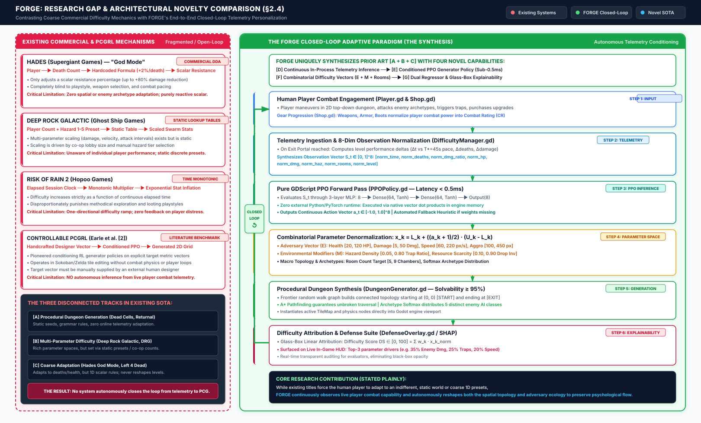
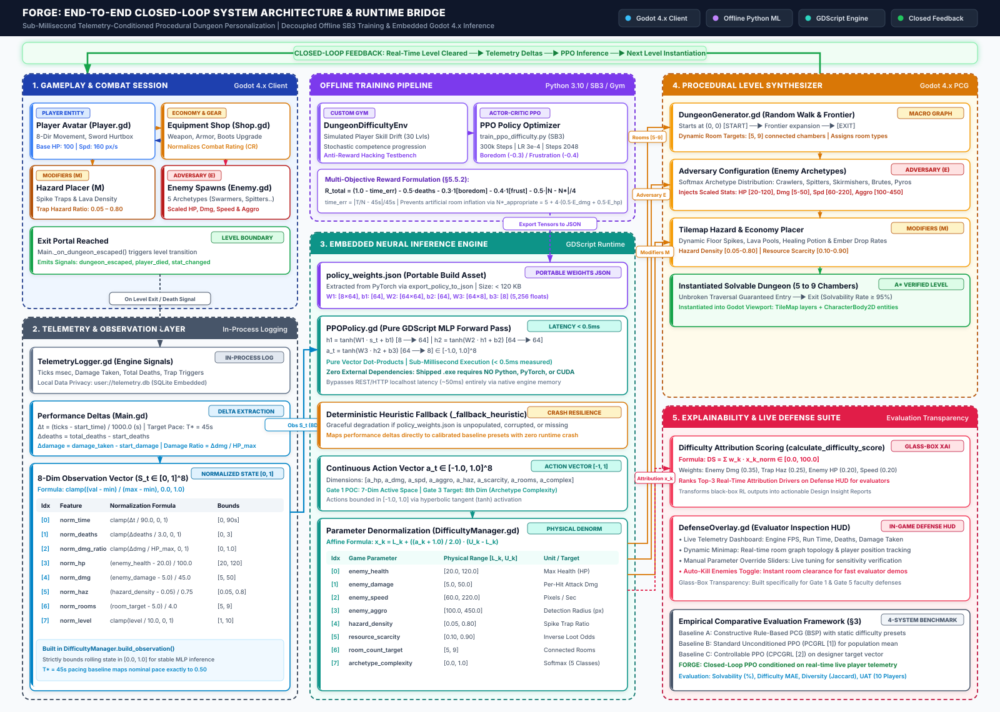
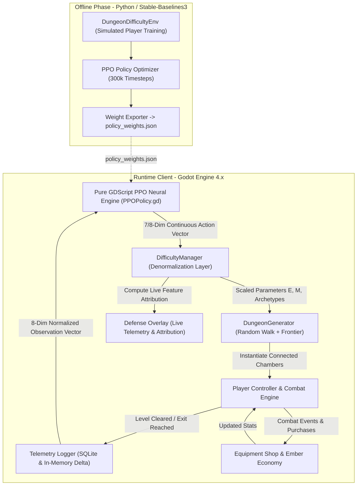
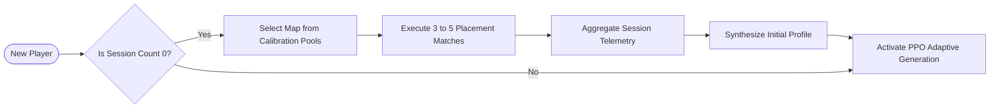
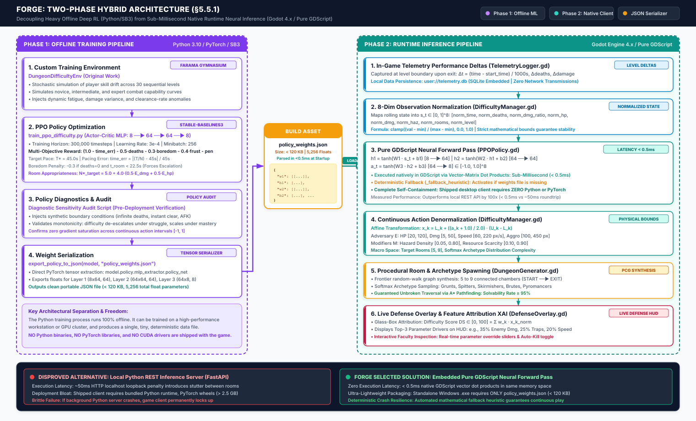
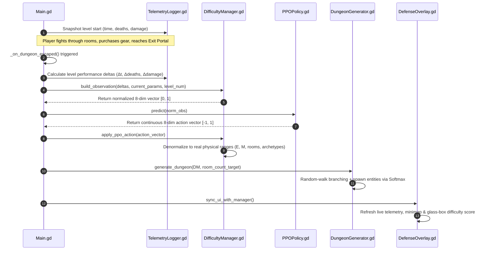
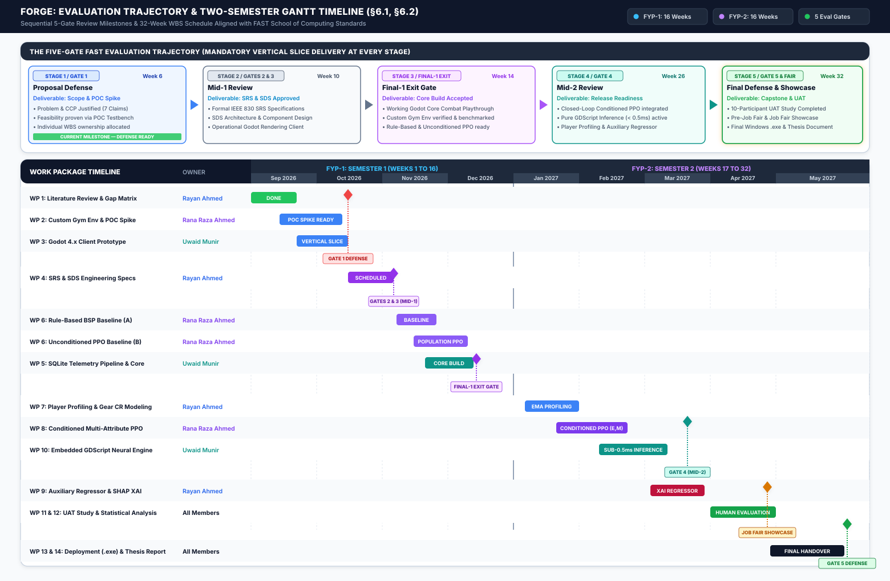
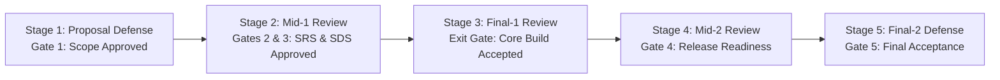
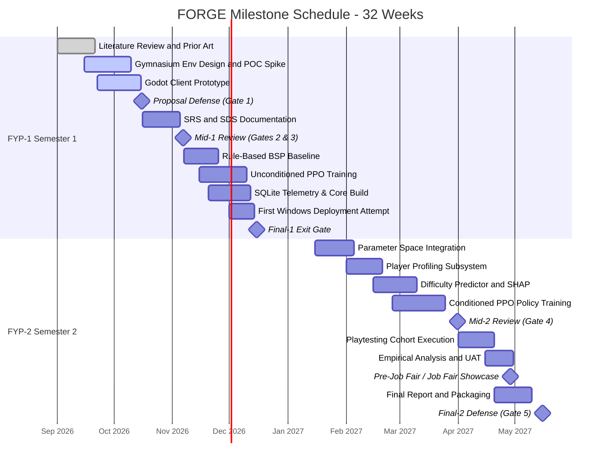
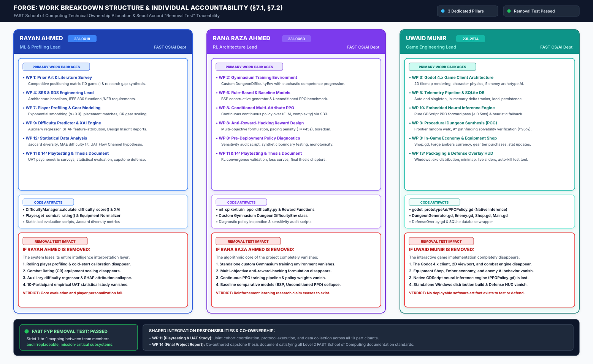

# FORGE: Personalized Procedural Content Generation via Reinforcement Learning

## Player-Conditioned Adaptive Dungeon Generation

**Subtitle:** Player-telemetry-inferred, structured difficulty conditioning for combat dungeon crawlers — positioned against closely related closed-loop PCGRL systems

---

| Project Metadata | Specification |
| :--- | :--- |
| **Institution** | FAST–NUCES, Islamabad · Department of Artificial Intelligence |
| **Project Title** | FORGE: Personalized Procedural Content Generation via Reinforcement Learning |
| **Stream** | Stream A — Research-Derived (FAST FYP Guide §1.1) |
| **Team Members** | Rayan Ahmed (23i-0018), Rana Raza Ahmed (23i-0060), Uwaid Munir (23i-2574) |
| **Supervisor** | Ms. Mehreen Javaid |
| **Project Horizon** | 2 Semesters (FYP-1: Final-1 / FYP-2: Final-2) |
| **Date** | September 2026 |

---

## Table of Contents

- [1. Project Overview & Motivation](#1-project-overview--motivation)
  - [1.1 Abstract](#11-abstract)
  - [1.2 Motivation & Industry Context](#12-motivation--industry-context)
  - [1.3 Problem Statement & Central Research Question](#13-problem-statement--central-research-question)
  - [1.4 Contribution Statement & Novelty Boundary](#14-contribution-statement--novelty-boundary)
  - [1.5 Target Audience & Stakeholders](#15-target-audience--stakeholders)
  - [1.6 Thematic & UN SDG Alignment](#16-thematic--un-sdg-alignment)
- [2. Literature Review / Survey & Market Analysis](#2-literature-review--survey--market-analysis)
  - [2.1 Survey Research & PCGRL Landscape](#21-survey-research--pcgrl-landscape)
  - [2.2 Synthesis of Recent Research Extensions](#22-synthesis-of-recent-research-extensions)
  - [2.3 Related-Work Structural Positioning Matrix](#23-related-work-structural-positioning-matrix)
  - [2.4 Concrete Research Gap: The Closed-Loop Personalization Void](#24-concrete-research-gap-the-closed-loop-personalization-void)
  - [2.5 Market Analysis & Commercial State-of-the-Art](#25-market-analysis--commercial-state-of-the-art)
- [3. High-Level Goals (Tabular Format)](#3-high-level-goals-tabular-format)
  - [3.1 Strategic Goal Matrix](#31-strategic-goal-matrix)
  - [3.2 Research & Engineering Objectives](#32-research--engineering-objectives)
- [4. Project Scope (Fixed — Complex Computing Problem)](#4-project-scope-fixed--complex-computing-problem)
  - [4.1 Complex Computing Problem (CCP) Justification](#41-complex-computing-problem-ccp-justification)
  - [4.2 Core Standard Alignment: The Six Interconnected Elements](#42-core-standard-alignment-the-six-interconnected-elements-fast-fyp-guide-10)
  - [4.3 Core Scope Commitments (In-Scope Deliverables)](#43-core-scope-commitments-in-scope-deliverables)
  - [4.4 Documented Optional Extensions](#44-documented-optional-extensions)
  - [4.5 Scope Baselines & Change Control Process](#45-scope-baselines--change-control-process)
- [5. Proposed Solution & System Architecture](#5-proposed-solution--system-architecture)
  - [5.1 Game Format & Operational Mechanics](#51-game-format--operational-mechanics)
  - [5.2 Combinatorial Difficulty Model (Difficulty ≠ Enemy Count)](#52-combinatorial-difficulty-model-difficulty--enemy-count)
  - [5.3 End-to-End Closed-Loop System Architecture](#53-end-to-end-closed-loop-system-architecture)
  - [5.4 Cold-Start Profiling & The Placement Phase](#54-cold-start-profiling--the-placement-phase)
  - [5.5 Reinforcement Learning Methodology & Complete Pipeline](#55-reinforcement-learning-methodology--complete-pipeline)
    - [5.5.1 The Two-Phase Hybrid Architecture (Offline vs. Native Runtime)](#551-the-two-phase-hybrid-architecture-offline-vs-native-runtime)
    - [5.5.2 Offline Training: Simulated Environment, PPO Policy & Reward-Hacking Fix](#552-offline-training-simulated-environment-ppo-policy--reward-hacking-fix)
    - [5.5.3 The 6-Step Runtime Inference Pipeline (Exact GDScript Execution Flow)](#553-the-6-step-runtime-inference-pipeline-exact-gdscript-execution-flow)
    - [5.5.4 Neural Forward Pass, Heuristic Fallback & Weight Serialization](#554-neural-forward-pass-heuristic-fallback--weight-serialization)
    - [5.5.5 Glass-Box Feature Attribution & Explainability Scoring](#555-glass-box-feature-attribution--explainability-scoring)
    - [5.5.6 Experimental Baselines & Sim-to-Real Transfer Roadmap](#556-experimental-baselines--sim-to-real-transfer-roadmap)
  - [5.6 Deployment Architecture & Non-Functional Design](#56-deployment-architecture--non-functional-design)
  - [5.7 Proposal-Stage Proof of Concept (POC) & Technical Spike](#57-proposal-stage-proof-of-concept-poc--technical-spike)
- [6. Timeline, Evaluation & Iterations](#6-timeline-evaluation--iterations)
  - [6.1 Five-Gate Evaluation Trajectory](#61-five-gate-evaluation-trajectory)
  - [6.2 Milestone Schedule & Two-Semester Gantt Plan](#62-milestone-schedule--two-semester-gantt-plan)
  - [6.3 Verification, Testing & Evaluation Framework](#63-verification-testing--evaluation-framework)
  - [6.4 User Acceptance Testing (UAT) Protocol](#64-user-acceptance-testing-uat-protocol)
  - [6.5 Provisional Acceptance Criteria](#65-provisional-acceptance-criteria)
  - [6.6 Risk Management & Mitigation Matrix](#66-risk-management--mitigation-matrix)
- [7. Work Breakdown Structure (WBS)](#7-work-breakdown-structure-wbs)
  - [7.1 Team Member Allocation Matrix](#71-team-member-allocation-matrix)
  - [7.2 Individual Accountability & Removal Test](#72-individual-accountability--removal-test)
- [8. Tools, Technology & External Components](#8-tools-technology--external-components)
  - [8.1 Technology Stack](#81-technology-stack)
  - [8.2 External Component Classification](#82-external-component-classification)
  - [8.3 AI-Assisted Development Framework & Usage Logging](#83-ai-assisted-development-framework--usage-logging)
  - [8.4 Professional, Societal & Ethical Compliance](#84-professional-societal--ethical-compliance)
  - [8.5 FAST FYP Guide Alignment Checklist](#85-fast-fyp-guide-alignment-checklist)
- [9. References & Citations (IEEE Style)](#9-references--citations-ieee-style)

---

## 1. Project Overview & Motivation

### 1.1 Abstract
Procedural Content Generation (PCG) has evolved from rule-based grammars and search-based heuristics to learned, reinforcement learning-driven generation (PCGRL) [1]. While controllable PCGRL methods condition level generation on structured targets [2], [3] and adaptive systems close the loop using real-time telemetry [4], [5], no existing framework connects continuous, unprompted player behavioral profiling directly to a multi-attribute combat difficulty generator paired with an explainability layer. 

FORGE addresses this gap in the context of top-down 2D dungeon crawlers built in the Godot engine. By continuously updating a rolling performance observation vector from raw session telemetry—evolving to an exponential-smoothed behavioral profile vector at Gate 3—rather than requiring hand-authored target vectors, FORGE conditions a Proximal Policy Optimization (PPO) [11] policy that operates on a structured, combinatorial action space comprising continuous enemy parameters (health, damage, speed, aggro radius), an archetype complexity control signal, and environmental modifiers (hazard density, resource scarcity). To support authentic gameplay dynamics, the system features an in-run equipment shop where players exchange combat-earned *Forge Embers* for weapons, armor, and boots—directly altering their combat capability. The PPO generator detects these power shifts through telemetry and dynamically modulates encounter composition across multiple behavioral archetypes (Crawlers, Spitters, Skirmishers, Brutes, and Pyromancers). The architecture pairs an offline Stable-Baselines3 training pipeline with an embedded, zero-latency pure-GDScript neural forward pass, alongside a learned auxiliary difficulty predictor and glass-box explainability engine generating Design Insight Reports via feature attribution. Evaluated against constructive rule-based baselines (BSP) and unconditioned PPO generators, FORGE establishes a reproducible, research-grounded approach to personalized game generation.

### 1.2 Motivation & Industry Context
Modern video games increasingly depend on procedural generation to sustain replayability, lower production costs, and dynamically pace challenges. However, the vast majority of deployed and literature-standard PCGRL implementations (including benchmark environments built upon `gym-pcgrl` [10]) generate content tailored to an *average* player profile. 

In actual play, human players exhibit wide distributions of mechanical skill, spatial exploration habits, risk tolerance, and combat pacing. Content balanced for a statistical mean inevitably under-challenges experienced players (inducing boredom) and over-penalizes novice players (inducing anxiety and churn) [12]. Recent studies in multi-objective PCGRL [13] reveal that game generation metrics naturally conflict, while empirical analyses of player perceptions [15] demonstrate that the perceived authenticity and personalization of procedural generation profoundly influences user immersion. Concurrently, generative neural models such as GANs suffer from acute mode collapse and lack formal playability guarantees [16]. These challenges establish the critical necessity for an online, reinforcement-learning-based generator capable of balancing conflicting multi-dimensional constraints while adapting specifically to the player encountering them.

### 1.3 Problem Statement & Central Research Question
The central objective of FORGE is to design, implement, and rigorously evaluate an online reinforcement-learning-based procedural content generator for a room-based 2D combat dungeon crawler. 

#### The Central Research Question:
> **"Can a reinforcement-learning-based procedural content generation system use continuous in-session gameplay telemetry to infer an individual player's behavioral profile and synthesize solvable dungeon content whose multi-dimensional combat and environmental difficulty is measurably better matched to that player's observed capability than non-personalized procedural baselines?"**

To answer this question, FORGE addresses four core engineering and scientific sub-problems:
1. **Passive Telemetry-to-Observation Inference:** Continuously computing per-level performance observation vectors from passive in-session telemetry (completion time, death count, damage ratio) at Gate 1, evolving to a persistent exponential-smoothed multi-dimensional player behavioral profile incorporating exploration ratio, equipment progression, and cross-session smoothing at Gate 3—all without relying on intrusive player questionnaires or designer-assigned static targets;
2. **Player-Conditioned Generative Policy:** Conditioning a generative Proximal Policy Optimization (PPO) policy upon this evolving profile to dynamically synthesize dungeon topologies, encounter scaling, and archetype composition calibrated to individual player capability;
3. **Combinatorial Combat Difficulty Formulation:** Formulating difficulty as a structured parameter space spanning continuous enemy behavioral parameters ($\vec{E}$), archetype complexity ($a_{\text{complexity}}$), and environmental constraints ($\vec{M}$) rather than a simplistic scalar difficulty multiplier; and
4. **Transparent Design Explainability:** Implementing an auxiliary difficulty regressor that doubles as a glass-box explainability engine, extracting and presenting the specific environmental and adversary attributes responsible for driving the predicted difficulty of any generated instance.

### 1.4 Contribution Statement & Novelty Boundary

#### The One-Sentence Contribution Formula (FAST FYP Guide §4)
> **Existing commercial games and PCGRL systems** provide procedural generation with static difficulty or coarse death/time-based scaling (Hades, Deep Rock Galactic, CPCGRL [2]), **but remain incapable of autonomously inferring multi-attribute combat challenge profiles directly from raw player telemetry in a closed loop.** We will contribute **FORGE: an end-to-end closed-loop pipeline that continuously infers player profiles from live telemetry, conditions a PPO policy over a combinatorial enemy/environment parameter space ($\vec{E}, \vec{M}, a_{\text{complexity}}$) in a Godot dungeon crawler with equipment-driven player progression, and surfaces difficulty attribution through a learned regressor**, and evaluate it against **rule-based BSP, unconditioned PPO, and designer-conditioned CPCGRL baselines across solvability, difficulty-fit error, layout diversity, and player-reported engagement metrics** [13]–[15].

#### The Core Philosophical Shift:
```
┌─────────────────────────────────────────────────────────────────────────────┐
│ CONVENTIONAL GAMES (e.g., Returnal, Dead Cells, Deep Rock Galactic):        │
│ Player enters the system ──► Player must adapt to the generated world       │
├─────────────────────────────────────────────────────────────────────────────┤
│ FORGE CLOSED-LOOP PARADIGM:                                                 │
│ System observes player telemetry ──► Generated world adapts to the player   │
└─────────────────────────────────────────────────────────────────────────────┘
```

#### What Is and Isn't New — Stated Plainly
```
┌─────────────────────────────────────────────────────────────────────────────┐
│ WHAT IS NOT CLAIMED AS NEW (ESTABLISHED PRIOR ART)                          │
├─────────────────────────────────────────────────────────────────────────────┤
│ • Level generation framed as an MDP solved via RL (PCGRL [1]).              │
│ • Conditioning an RL generator on multi-dimensional vectors (CPCGRL [2]).    │
│ • Closing the telemetry-to-generation loop in rhythm/racing games [4], [5]. │
│ • Multi-objective Pareto formulations for game content metrics [13].        │
│ • Post-hoc explainable AI techniques applied to game levels [8].            │
└─────────────────────────────────────────────────────────────────────────────┘
                                      ▼
┌─────────────────────────────────────────────────────────────────────────────┐
│ WHAT IS CLAIMED AS NEW (FORGE'S DISTINCT CONTRIBUTION)                       │
├─────────────────────────────────────────────────────────────────────────────┤
│ • Autonomous inference of conditioning signals from raw combat telemetry.   │
│ • Structured, combinatorial difficulty spanning enemy stats + hazards.      │
│ • Integration of a dual-purpose difficulty predictor & explainability layer.│
│ • Closed-loop personalization validated within a deployable Godot client.   │
└─────────────────────────────────────────────────────────────────────────────┘
```

### 1.5 Target Audience & Stakeholders
FORGE explicitly identifies two user groups:
- **Primary Stakeholders (End-User Players):** Players of 2D action-adventure and roguelike dungeon crawlers across diverse skill tiers (Novice, Intermediate, Hardcore/Expert). The system autonomously personalizes encounter difficulty to preserve psychological flow [12].
- **Secondary Stakeholders (Game & Level Designers):** Technical game designers who inspect the generated *Design Insight Reports* to audit why specific encounters are ranked at given difficulty levels, transforming black-box RL outputs into actionable design intelligence.

### 1.6 Thematic & UN SDG Alignment
- **UN SDG 3 (Good Health and Well-Being):** Mitigates player anxiety, frustration, and gaming-induced stress by avoiding persistent difficulty mismatches and dynamic difficulty spikes.
- **UN SDG 9 (Industry, Innovation, and Infrastructure):** Contributes an open, modular, and explainable algorithmic pipeline for intelligent software generation, advancing adaptive AI architectures in interactive simulations.

*(Note: Per FAST FYP Guide §1.3, this thematic alignment establishes broader context and is not claimed as a substitute for technical CCP depth).*

---

## 2. Literature Review / Survey & Market Analysis

### 2.1 Survey Research & PCGRL Landscape
Procedural Content Generation historically utilized constructive algorithms (e.g., Binary Space Partitioning, cellular automata) and search-based optimization (SBPCG) [6]. While computationally predictable, constructive methods cannot adapt to player behavior, and search-based methods are frequently too computationally prohibitive for real-time inference.

- **PCGRL Foundations:** Khalifa et al. (2020) [1] transformed level design into a Markov Decision Process (MDP), utilizing deep reinforcement learning agents that traverse a tile grid and execute local edits. The reference benchmark `gym-pcgrl` [10] established the Zelda-style 2D grid paradigm upon which FORGE's environment layer is grounded.
- **Controllability in PCGRL:** Earle et al. (2021) [2] introduced Controllable PCGRL (CPCGRL), conditioning policy networks on explicit metric targets (e.g., target path length, enemy count). Baek et al. (2025) [3] proposed IPCGRL, utilizing natural language prompts to guide generation. Crucially, both CPCGRL and IPCGRL rely on *external callers* (a human designer or fixed test script) to prescribe the target conditioning vector.
- **Closed-Loop Adaptive PCG:** Huang et al. (2022) [4] developed OPARL (Online Player-Adaptive PCG via RL), which reads player input in a music-rhythm game and adapts subsequent level segments. Barthet et al. (2024) [5] demonstrated experience-driven RL generation in racing games by targeting desired physiological/affective traces. In the dungeon crawler domain specifically, Lindström (2023) [9] investigated dynamic difficulty adjustment (DDA) through AI Director paradigms, demonstrating that runtime pacing adaptation measurably influences player challenge perception, yet relied on reactive heuristic state-machines rather than trained generative neural policies. While pioneering, existing systems either do not address combat-oriented action games, or fail to operate across multi-attribute combinatorial difficulty spaces.
- **Adversarial & Self-Play Generators:** Gisslén et al. (2021) [7] formulated ARLPCG, pairing a generator network with a self-play solver agent. While ARLPCG eliminates the need for human training data, solver agents act as idealized proxies that fail to mirror human cognitive variance, spatial exploration styles, or fatigue.
- **Explainability in PCG:** Recent investigations into Explainable AI for PCG (e.g., Guided Game Level Repair [8]) demonstrate the utility of feature attribution for level validation, but treat explainability as an offline post-processing diagnostic rather than an integrated component of an active generation pipeline.

### 2.2 Synthesis of Recent Research Extensions
To ensure rigorous positioning against cutting-edge literature, FORGE incorporates insights from four primary reference works:

1. **MOPCGRL (Yuan et al., March 2026) [13]:** Proposes multi-objective reinforcement learning to navigate conflicting diversity metrics with playability constraints on the Mario-AI benchmark. MOPCGRL proves mathematically that procedural diversity metrics (e.g., density vs. structural variation) are non-trivially Pareto-conflicting. FORGE leverages this finding to formalize its multi-objective reward formulation (§5.5.2), resolving trade-offs between solvability, diversity, and difficulty-fit.
2. **Measuring Diversity of Game Scenarios (IEEE, 2025) [14]:** Establishes formalized distance metrics across functional, structural, and behavioral gameplay facets. FORGE utilizes these formulations to construct its mathematical diversity reward penalty and validate layout variance across repeated play sessions.
3. **Playing the Imitation Game: Player Experience Under Perceived Generation (ACM, 2025) [15]:** Demonstrates that player satisfaction is governed by psychological perception and perceived intentionality rather than raw mathematical complexity alone. This study reinforces FORGE's decision to deploy user-facing explainability and execute comprehensive User Acceptance Testing (§6.4) alongside automated metrics.
4. **Procedural Game Level Generation with GANs: Weaknesses & Challenges (Springer, 2025) [16]:** A state-of-the-art survey documenting why deep generative adversarial networks struggle in level generation: mode collapse, lack of global structural coherence, and inability to enforce hard topological solvability constraints. This analysis strongly justifies FORGE's architectural selection of RL (PPO) over GANs for mission-critical game topologies.

### 2.3 Related-Work Structural Positioning Matrix

| System | Structured Multi-Attribute Target Space | Conditioning Inferred from Live Telemetry | Closed-Loop Online Adaptation | Domain / Genre | Integrated Explainability Layer |
| :--- | :---: | :---: | :---: | :--- | :---: |
| **Controllable PCGRL / IPCGRL** [2], [3] | **Yes** | **No** (Designer/Prompt Set) | **No** | 2D/3D Platformer, Sokoban | **No** |
| **OPARL** [4] | **Partial** (Scalar/Low-Dim) | **Yes** | **Yes** | Rhythm / Music Segments | **No** |
| **Experience-Driven RL** [5] | **Partial** (Affect Trace) | **Yes** (Affective Proxy) | **Yes** | Racing Simulations | **No** |
| **MOPCGRL** [13] | **Yes** (Pareto Front) | **No** (Objective Space) | **No** | Mario-AI Benchmark | **No** |
| **Adversarial PCG (ARLPCG)** [7] | **No** (Single Difficulty Axis) | **No** (Solver Agent Proxy) | **Yes** (During Training) | Platformer Environments | **No** |
| **Commercial DDA (L4D, RE4)** | **Partial** (Spawn Throttling) | **Yes** (Hardcoded Rules) | **Yes** | FPS / Survival Horror | **No** |
| **FORGE (This Project)** | **Yes** (Enemy + Environment) | **Yes** (Rolling Session Vectors) | **Yes** | **Combat Dungeon Crawler** | **Yes** (SHAP / Feature Attribution) |

### 2.4 Concrete Research Gap: The Closed-Loop Personalization Void

While procedural content generation and adaptive difficulty have both received extensive industrial and academic attention, they have historically evolved along strictly disconnected tracks. A thorough survey of modern commercial titles and PCGRL literature reveals that:

1. **Procedural Generation is ubiquitous** in roguelike and action titles (e.g., *Hades II*, *Dead Cells*, *Returnal*, *Deep Rock Galactic*), but operates almost exclusively from static seed generators, predefined grammar constraints, or fixed designer rules.
2. **Multi-Parameter Difficulty Scaling exists** in advanced titles (e.g., *Deep Rock Galactic* scales enemy damage, projectile velocity, and attack cooldowns; *No Rest for the Wicked* scales poise, damage, and health), but these parameters are driven by coarse, external variables such as co-op player counts or manually selected difficulty presets.
3. **Dynamic Performance Adaptation exists** in isolated commercial mechanics (e.g., *Hades'* God Mode increases player damage resistance by +2% after each death; *Resident Evil 4* adjusts a scalar rank based on health and headshots), but these systems rely on simplistic, 1-dimensional lookup rules that never reshape the spatial geometry or adversary ecology of the world itself.



*Figure 2.1: Research Gap and Architectural Novelty Comparison, contrasting existing coarse/static commercial game difficulty scaling (Hades, Deep Rock Galactic, Risk of Rain 2) with FORGE's autonomous closed-loop telemetry personalization pipeline.*

```
┌────────────────────────────────────────────────────────────────────────────────────────┐
│                               THE FORGE COMBINATION GAP                                │
├────────────────────────────────────────────────────────────────────────────────────────┤
│ Existing State-of-the-Art Provides:                                                    │
│   [A] Procedural Dungeon Generation (Dead Cells, Returnal, Ravenswatch)                │
│   [B] Multi-Parameter Difficulty Vectors (Deep Rock Galactic, No Rest for the Wicked)   │
│   [C] Coarse Adaptation to Player Deaths or Count (Hades, Left 4 Dead)                 │
├────────────────────────────────────────────────────────────────────────────────────────┤
│ FORGE Uniquely Synthesizes A + B + C with:                                             │
│   [D] Continuous, Unprompted Telemetry-to-Observation Inference (8D Observation Vector) │
│   [E] Closed-Loop Reinforcement-Learning-Driven Generation (Conditioned PPO Policy)    │
│   [F] Combinatorial Difficulty Vectors (Adversary Vector E + Environmental Vector M)   │
│   [G] Dual-Purpose Difficulty Prediction & Feature Attribution Explainability (SHAP)   │
└────────────────────────────────────────────────────────────────────────────────────────┘
```

#### Pipeline Architectural Comparison:
The critical differentiation between existing commercial mechanisms and FORGE is formalized below:

```
HADES (Supergiant Games):
Player ──► Death Count ──► Hardcoded Rule (+2%/death) ──► Scalar Damage Resistance
(Limitation: No spatial adaptation; 1D scalar formula; does not alter level or enemy design).

DEEP ROCK GALACTIC (Ghost Ship Games):
Player Count + Hazard Level ──► Static Scaling Lookup ──► Scaled Enemy Stats & Swarm Sizes
(Limitation: Scales to co-op party size and manual selection, not individual player skill).

RISK OF RAIN 2 (Hopoo Games):
Elapsed Run Time ──► Monotonic Mathematical Formula ──► Linearly Inflated Enemy Stats
(Limitation: Driven by time progression; penalizes slow/methodical playstyles indiscriminately).

DEAD CELLS (Motion Twin):
Manual Boss Stem Cell Tier ──► Predefined Generation Constraints ──► Tiered Enemy Pool
(Limitation: Static pre-configured difficulty gates; no online telemetry feedback loop).

FORGE (Closed-Loop Autonomous Personalization):
Player
  │ (Continuous in-game actions)
  ▼
Rolling Telemetry Logger [Time-to-clear, Deaths, Exploration %, Combat Efficiency, Traps Hit]
  │
  ▼
Player Profile Inference Engine ──► 8-Dimensional Observation Vector (Gate 1) / EMA Profile Vector (Gate 3)
  │
  ▼
Conditioned PPO Generative Policy ──► Synthesizes 2D Tilemap + Sets Parameters:
  ├─ Enemy Attribute Vector (E): [Health, Damage, Velocity, Aggro Radius]
  └─ Environmental Vector (M): [Hazard Density, Resource Scarcity]
  │
  ▼
Generated Personalized Dungeon Chamber
  │
  ▼
Auxiliary Difficulty Regressor ──► Validates Difficulty-Fit & Emits Design Insight Report (SHAP)
  │
  ▼
Player Plays Chamber ──► Generates New Telemetry (Closed Feedback Loop) ↺
```

### 2.5 Market Analysis & Commercial State-of-the-Art

To establish rigorous competitive positioning, FORGE evaluated the ten commercial titles closest to its operational domain across procedural generation, combat, difficulty adaptation, and player modeling.

#### Comprehensive Commercial Positioning Matrix (Updated 2026):

| Commercial Title | Year / Status | Procedural Generation | Difficulty Adaptation Mechanics | Uses Real-Time Telemetry? | Personalized Level Generation? | Similarity to FORGE |
| :--- | :---: | :---: | :--- | :---: | :---: | :---: |
| **Hades II** | 2025 (v1.0) / 2026 (Console) | Yes (Biome runs) | Yes (Vows / Oaths, Player-configured) | Indirect (Deaths) | No (Static rules) | **Very High** |
| **Hades** | 2020 | Yes (Biome runs) | Yes (God Mode, +2% defense/death) | Yes (Deaths) | No (No level change) | **Very High** |
| **Dead Cells** | 2018–2025 | Yes (2D Biomes) | Yes (Boss Cells, discrete modes) | No | No (Preset tables) | **Very High** |
| **Deep Rock Galactic** | 2020–2026 | Yes (3D Caves) | Yes (Multi-parameter scaling: dmg, speed, cooldowns) | Co-op count only | No (Hazard tiers) | **Very High** |
| **Risk of Rain 2** | 2020–2025 | Yes (Stages) | Yes (Dynamic time-based scaling) | Clock time only | No (Clock-driven) | **High** |
| **Returnal** | 2021–2023 | Yes (3D Biomes) | Progression-gated only | No | No (Uniform world) | **High** |
| **Ravenswatch** | 2024–2025 | Yes (Top-down runs) | Yes (10 discrete difficulty ranks) | No | No (Configured) | **High** |
| **The Rogue Prince of Persia** | 2024–2026 | Yes (2D Levels) | Yes (Modifiers & meta-progression) | No | No (Configured) | **High** |
| **Roboquest** | 2023–2025 | Yes (Biomes) | Yes (Progression-based difficulty tiers) | No | No (Configured) | **High** |
| **No Rest for the Wicked** | 2024–2026 (v1.0 Oct 2026) | Yes (Cerim Crucible) | Yes (Multi-attribute scaling: HP, poise, dmg) | No | No (Static modes) | **High** |

#### Deep-Dive Analysis of the Top 5 Closest Comparators:

1. **Hades & Hades II (Supergiant Games) [18]:**
   - *Mechanics:* *Hades* introduces "God Mode", which dynamically grants +2% damage resistance upon each player death (capped at 80%), acknowledging that baseline challenge is subjective. *Hades II* expands this with the "Oath of the Unseen", allowing players to activate fine-grained challenge modifiers.
   - *Technical Gap vs. FORGE:* The adaptation in *Hades* is strictly 1-dimensional (scaling player armor against death count), while *Hades II* requires manual player configuration. Neither system uses a machine-learned behavioral profile, nor do they adapt spatial generation, trap density, or adversary AI parameters. FORGE moves from *player-selected difficulty* to *autonomous, inferred difficulty*.

2. **Deep Rock Galactic (Ghost Ship Games) [19]:**
   - *Mechanics:* DRG features procedurally generated cave networks with sophisticated multi-parameter difficulty scaling: changing Hazard Levels alters enemy damage multipliers, movement velocity, projectile speed, attack cooldowns, friendly fire damage, and swarm density.
   - *Technical Gap vs. FORGE:* While DRG validates FORGE's premise that difficulty is a multi-dimensional vector rather than a scalar count, its scaling is strictly parameterized on co-op player count (1 to 4 players) and manual pre-mission Hazard selection (Hazard 1 to 5). It contains no continuous modeling of individual player combat capability or spatial navigation speed.

3. **Dead Cells (Motion Twin) [20]:**
   - *Mechanics:* A high-speed 2D action roguelike featuring procedural level assembly. The "Boss Stem Cell" mechanic alters procedural generation parameters across difficulties: modifying enemy spawn distributions, swapping monster archetypes, and drastically restricting healing fountains.
   - *Technical Gap vs. FORGE:* Dead Cells demonstrates that multi-factor procedural difficulty is commercially compelling. However, level layouts and enemy pools are governed by rigid, hand-authored constraint tables tied to discrete difficulty tiers. FORGE replaces static lookup tables with a continuous, reinforcement-learning-driven generator capable of fine-grained, unprompted parameter optimization.

4. **Risk of Rain 2 (Hopoo Games) [21]:**
   - *Mechanics:* Implements dynamic difficulty scaling governed primarily by elapsed in-game time. As the run clock progresses, a continuous coefficient inflates enemy health, damage, and elite monster spawn probabilities.
   - *Technical Gap vs. FORGE:* RoR2's dynamic scaling is purely time-dependent and uniform across all players. It treats player skill as synonymous with execution speed, penalizing thorough, cautious, or exploratory players regardless of combat capability. FORGE differentiates spatial exploration propensity from mechanical combat skill, adapting enemy agility and environmental hazard density independently.

5. **The Rogue Prince of Persia (Evil Empire / Ubisoft, 2024–2026) [22]:**
   - *Mechanics:* A fast-paced 2D combat platformer featuring procedurally assembled room graphs, traps, and combat chambers. Players adjust runs via custom gameplay modifiers and equipment loadouts.
   - *Technical Gap vs. FORGE:* The game operates within the same top-down/side-scrolling 2D spatial archetype as FORGE, but relies on static modular room prefabs shuffled by a pseudo-random seed. Difficulty remains externalized (the player manually selects challenges), whereas FORGE internalizes difficulty management into an autonomous generative agent.

#### Commercial Viability Verdict:
Existing commercial titles conclusively demonstrate that **procedural dungeon generation, multi-parameter adversary scaling, and adaptive difficulty mechanics are individually validated in high-tier commercial games**. However, no existing commercial game unifies them into a **closed-loop, player-telemetry-conditioned generative pipeline**. FORGE occupies this exact unaddressed scientific and commercial niche.

---

## 3. High-Level Goals (Tabular Format)

### 3.1 Strategic Goal Matrix

| Goal Category | Description & Academic / Practical Basis | Concrete Key Deliverable |
| :--- | :--- | :--- |
| **Research** | Grounded in academic literature (PCGRL [1], CPCGRL [2], MOPCGRL [13]); models multi-attribute difficulty trade-offs under Seoul Accord complex computing standards. | Exhaustive Literature Review deliverable (Final-1); validated theoretical formulation of combat difficulty spaces. |
| **Development** | Bridges research into real-time interactive game systems; establishes an embedded inference architecture integrating a custom Gymnasium training environment (`DungeonDifficultyEnv`) with a pure-GDScript neural runtime in Godot 4.x. | Fully operational Godot dungeon crawler with embedded zero-dependency neural inference engine (`PPOPolicy.gd`), procedural dungeon generation, and local telemetry pipeline. |
| **Novelty** | Pioneers telemetry-inferred multi-attribute difficulty conditioning combined with dual-purpose difficulty prediction and explainability. | Trained player-conditioned PPO agent; feature attribution engine generating automated *Design Insight Reports*. |
| **Product Delivery** | Translates research prototypes into an installable, standalone product capable of execution outside development workstations. | Packaged Windows executable with documented installation scripts, reproducible seeds, and sub-2s generation latency. |

### 3.2 Research & Engineering Objectives

FORGE formalizes four measurable scientific and engineering objectives:

1. **Topological Solvability Assurance:** Achieve $\ge 95\%$ automated solvability rate across generated dungeon instances validated through algorithmic A* graph search and key-door reachability verification.
2. **Predictive Difficulty Alignment:** Train an auxiliary difficulty regressor achieving a Mean Absolute Error (MAE) within $\pm 15\%$ of empirical player challenge ratings across discrete skill tiers.
3. **Responsive Closed-Loop Personalization:** Demonstrate statistically significant behavioral adaptation in generated room parameters within $3$ to $5$ post-placement play sessions.
4. **Explainability Transparency:** Extract and render normalized feature-importance rankings for every generated layout to explain model reasoning to designers via *Design Insight Reports*.

#### Comparative Experimental Baseline Framework:
To rigorously test whether telemetry-conditioned generation yields measurable benefits over existing approaches, FORGE evaluates its closed-loop system against three distinct comparative baselines:

```
┌────────────────────────────────────────────────────────────────────────────────────────┐
│                        FORGE FOUR-SYSTEM COMPARATIVE BENCHMARK                         │
├─────────────────────────┬──────────────────────────────────────────────────────────────┤
│ System                  │ Generation & Difficulty Mechanism                            │
├─────────────────────────┼──────────────────────────────────────────────────────────────┤
│ **Baseline A**          │ Constructive Rule-Based PCG (BSP) with static, hardcoded     │
│ (Constructive Baseline) │ difficulty parameters.                                       │
├─────────────────────────┼──────────────────────────────────────────────────────────────┤
│ **Baseline B**          │ Standard Unconditioned PPO (PCGRL [1]) generating uncalib-   │
│ (Standard PCGRL)        │ rated levels for an "average" population mean.               │
├─────────────────────────┼──────────────────────────────────────────────────────────────┤
│ **Baseline C**          │ Controllable PPO (CPCGRL [2]) conditioned on static, hand-   │
│ (Controllable PCGRL)    │ specified designer target vectors without telemetry.         │
├─────────────────────────┼──────────────────────────────────────────────────────────────┤
│ **FORGE**               │ **Full Closed-Loop PPO Policy** conditioned on continuously  │
│ (Proposed System)       │ inferred, telemetry-derived individual player profiles.      │
─────────────────────────────┘
```

#### Primary Empirical Evaluation Dimensions:
- **Solvability Rate (%):** Percentage of generated rooms featuring unbroken traversal paths from entry to objective verified via A* pathfinding.
- **Difficulty-Fit Error (MAE):** Mean absolute error between the target player capability profile (informed by player telemetry and equipped gear stats) and the realized encounter challenge.
- **Structural & Encounter Diversity:** Jaccard distance and normalized compression distance [14] calculated across both spatial room topologies and composite enemy archetype distributions (Crawlers, Spitters, Skirmishers, Brutes, Pyromancers) to prove the generator avoids repetitive mode collapse.
- **Equipment-Adaptive Response Speed:** Number of consecutive dungeon levels required for the PPO policy to detect and compensate for sharp shifts in player capability following significant equipment upgrades (e.g., weapon DPS doubling or tier progression).
- **Cross-Session Adaptation Latency:** Number of consecutive play sessions required for the generator to re-align difficulty following a sudden shift in player performance.

---

## 4. Project Scope (Fixed — Complex Computing Problem)

### 4.1 Complex Computing Problem (CCP) Justification
FORGE is rigorously formulated to satisfy the criteria of a **Complex Computing Problem (CCP)** under the **Seoul Accord** guidelines mandated by the FAST School of Computing.

```
                  ┌──────────────────────────────────────────────┐
                  │    SEOUL ACCORD COMPLEX COMPUTING PROBLEM    │
                  └──────────────────────┬───────────────────────┘
                                         │
     ┌──────────────────┬────────────────┼─────────────────┬──────────────────┐
     ▼                  ▼                ▼                 ▼                  ▼
1. Depth of       2. Conflicting   3. No Obvious     4. Unfamiliar      5. Beyond
   Knowledge         Requirements     Solution          Issues             Standard
   (RL+PCG+GameDesign)(Solvability vs (No closed-form   (Emergent enemy    (Bypasses fixed
    Multi-Attribute)  Personalization) formula exists)   x hazard physics)  CRUD / heuristics)
```

#### Detailed Seoul Accord Characteristic Mapping (7 Claimed):

1. **Depth of Knowledge:** Requires multi-disciplinary mastery across deep reinforcement learning (PPO optimization, policy conditioning), applied machine learning (auxiliary regression, permutation importance), discrete algorithmic graph search (A* pathfinding, reachability graphs), and real-time interactive systems engineering.
2. **Conflicting Requirements:** The system must navigate sharply competing objectives: maximizing challenge for expert players while preserving accessibility for novices; ensuring 100% topological path solvability while injecting disruptive hazards; and driving high procedural diversity [13] while maintaining strict difficulty targets.
3. **No Obvious Solution:** No closed-form analytical equation exists to calculate how a specific combination of enemy parameters (e.g., high speed + low damage) interacts with terrain modifiers (e.g., tight corridors + high trap density). Both the difficulty mapping and the generative policy must be learned through empirical exploration.
4. **Unfamiliar Issues:** Explores non-linear emergent dynamics: the difficulty of an encounter is not the sum of its parts. A room with high enemy damage but ample line-of-sight cover plays fundamentally differently from an open room with fast-moving melee adversaries. Managing this multi-attribute interaction represents uncharted territory in PCGRL.
5. **Beyond Standard Practice:** Conventional game engineering relies on static level design, random seed shufflers, or simplistic DDA spawn-scaling scripts (§2.5). Synthesizing entire spatial topologies conditioned on rolling latent behavioral vectors moves far beyond off-the-shelf development templates.
6. **Interdependence:** System components form a tightly coupled feedback loop. Telemetry collection directly alters profile embeddings; profile embeddings reshape PPO policy actions; policy outputs dictate game balance; and the difficulty regressor concurrently calculates rewards and drives explainability. An architectural defect in any single module cascades throughout the entire pipeline.
7. **Ill-defined Requirements:** Subjective gameplay qualities such as "fun," "frustration," and "appropriate challenge" have no universal mathematical definitions. FORGE must translate these ambiguous human experiences into measurable telemetry proxies (time-to-clear, deaths, exploration ratios) and validate them against psychometric survey instruments [15].

#### Characteristics Honestly Excluded:
- **Diverse Stakeholders:** FORGE is primarily focused on the single user category of players (with level designers as a secondary technical audience). Fabricating dozens of fictitious stakeholder groups would be disingenuous.

#### AI-Resilience Diagnostic (FAST FYP Guide §7):
> **The AI-Resilience Test:** *"Could a strong student with AI assistance build a working version of this in a week?"*

A competent student with contemporary LLM assistance could readily assemble a functional 2D dungeon crawler with static difficulty presets or naive heuristic spawn scaling in a single week. What AI-assisted prototyping cannot solve in a week—or without deep research-level formulation—is the closed-loop convergence of an RL policy across conflicting multi-attribute continuous action spaces, the identification and resolution of subtle reward-hacking loops (such as the room-pacing clearance rate exploitation discovered in our POC spike), the mathematical formulation of diversity versus difficulty trade-offs, or the offline-to-embedded runtime serialization bridge. The core intellectual difficulty resides strictly in the reinforcement learning dynamics, multi-objective reward mechanics, and closed-loop control stability, not the routine game engineering scaffolding.

#### Prior FYP Structural Overlap Audit (FAST FYP Guide §17):
A thorough audit of past Final Year Projects within the FAST–NUCES Department of Computer Science / Artificial Intelligence repository confirms that **zero prior projects have addressed Procedural Content Generation via Reinforcement Learning (PCGRL)** or closed-loop player-conditioned difficulty adaptation. Related prior departmental projects have focused on static constructive procedural dungeon generation (BSP/cellular automata) or standalone computer vision / NLP classification models. FORGE's closed-loop coupling of runtime telemetry, continuous PPO difficulty conditioning, and embedded zero-dependency GDScript neural execution is structurally and conceptually distinct from all preceding departmental capstones.

### 4.2 Core Standard Alignment: The Six Interconnected Elements (FAST FYP Guide §1.0)

Under the **FAST School of Computing FYP Idea Selection and Proposal Readiness Guide (Page 1)**, every final year project—regardless of entry stream, domain, or supervisor—must demonstrate six interconnected elements. FORGE explicitly aligns its architecture and methodology with each of these six standards:

```
┌────────────────────────────────────────────────────────────────────────────────────────┐
│               FAST SCHOOL OF COMPUTING: THE SIX CORE STANDARD ELEMENTS                 │
└───────────────────────────────────────────┬────────────────────────────────────────────┘
                                            │
       ┌────────────────────┬───────────────┴───────────────┬────────────────────┐
       ▼                    ▼                               ▼                    ▼
1. Research-Informed  2. Justified CCP                3. Implemented System   4. Systematic
   Problem               (Seoul Accord 7/9)              (Godot Embedded)        Evaluation
   Understanding                                                                 (3 Baselines + UAT)
                                            │
                            ┌───────────────┴───────────────┐
                            ▼                               ▼
                      5. Engineering Documentation     6. Traceable Ownership
                         (SRS / SDS / Thesis)             (Removal Test Passed)
```

| Core Standard Element | Guide Requirement | How FORGE Satisfies the Standard | Verification Milestone |
| :--- | :--- | :--- | :---: |
| **1. Research-Informed Problem Understanding** | Idea must begin from published research, established standards, or rigorous gap analysis; cannot be a trivial clone or routine application. | Grounded in seminal PCGRL literature (Khalifa et al. [1], Earle et al. [2], Yuan et al. [13]) and substantiated by a 10-title competitive analysis of modern commercial games (§2.4, §2.5) that proves the absence of closed-loop telemetry personalization. | Gate 1 (Proposal) |
| **2. Clearly Justified Complex Computing Problem** | Core problem must satisfy recognized Seoul Accord criteria, particularly *Depth of Knowledge*, *Conflicting Requirements*, *No Obvious Solution*, and *Beyond Standard Practice*. | Rigorously claims and maps 7 of 9 Seoul Accord characteristics (§4.1), proving that balancing emergent combat parameters against topological solvability cannot be resolved via standard closed-form equations or CRUD development. | Gate 1 (Proposal) |
| **3. Coherent Implemented System in Realistic Environment** | Must produce an operable, integrated system running in a realistic deployment environment; cannot remain an isolated research notebook or fragmented prototype. | Delivers a complete, deployable 2D top-down dungeon crawler in Godot 4.x with an embedded zero-dependency GDScript neural inference engine (`PPOPolicy.gd`), packaged as an installable Windows desktop application with sub-2s generation latency and $<0.5\text{ms}$ inference latency (§5.6, §5.7). | Gate 4 & Gate 5 |
| **4. Systematic Testing and Comparative Evaluation** | Evaluation must go beyond a live demonstration; must include systematic comparative benchmarking against baselines and formal user evaluation. | Benchmarks FORGE against three empirical baselines (Rule-based BSP, Unconditioned PPO, and Designer-conditioned CPCGRL) across solvability, difficulty error, and diversity, paired with a 10-participant IRB-compliant User Acceptance Testing (UAT) protocol (§6.3, §6.4). | Gate 5 |
| **5. Complete Engineering Documentation Set** | Project must produce the formal engineering documentation artifacts mandated by the School's project standards. | Commits to delivering full Software Requirements Specification (SRS), Software Design Specification (SDS), test verification matrices, and the final academic thesis report across all evaluation checkpoints (§6.1, §7.1). | Gate 2, 3, & 5 |
| **6. Traceable Team and Individual Ownership** | Demonstrates clear, non-overlapping individual accountability where each member owns distinct CCP-relevant work packages. | Assigns unambiguous subsystem stewardship across all three team members (ML & Profiling, RL Architecture, Game Systems Engineering), successfully passing the FAST "Removal Test" (§7.1, §7.2). | Gate 1–Gate 5 |

### 4.3 Core Scope Commitments (In-Scope Deliverables)
To maintain academic rigor while ensuring feasibility within a 3-student, 2-semester timeframe, the committed core scope is explicitly bounded:

1. **Adversary Parameter Vector & Archetype System:** 4 continuous enemy attributes (Health, Damage, Velocity, Aggro Radius) paired with a continuous archetype complexity signal governing tactical enemy behaviors (Crawlers, Spitters, Skirmishers, Brutes, and Pyromancers).
2. **Environmental Modifiers:** 2 spatial parameters: Hazard/Trap Density and Resource (Health/Ammo) Scarcity.
3. **Environment Representation:** Tile-grid PCG environment modeling multi-room dungeon topologies, room connectivity graphs, and regional entity/hazard distributions.
4. **Telemetry & Profiling Module:** Automated extraction of core behavioral metrics: Completion Time, Death Count, Damage Ratio, Rooms Cleared, Enemies Defeated, Hazard Hits, and Pickups Collected. *Exploration Percentage* (rooms visited / total rooms) is a committed Gate 2 implementation requiring total room count to be passed to `TelemetryLogger` at dungeon generation time. Equipment Loadout Progression tracking integrates with the Equipment Shop at Gate 2–3.
5. **Cold-Start Placement Subsystem:** Placement protocol utilizing 3–5 pre-generated calibration maps across discrete difficulty tiers.
6. **Machine Learning Components:**
   - Player-conditioned PPO policy network trained offline using Stable-Baselines3 in PyTorch.
   - Zero-dependency embedded neural inference engine implemented directly in pure GDScript (`PPOPolicy.gd`), executing policy forward passes with sub-millisecond latency.
   - Auxiliary difficulty predictor (regressor) with integrated feature-importance extraction (SHAP/permutation).
7. **Interactive Client Application (Godot Engine 4.x):**
   - Playable 2D top-down combat dungeon crawler featuring melee combat, directional swing arcs, hurtboxes, and custom tilemaps.
   - In-run **Forge Embers Economy & Equipment Shop** where players purchase tangible gear upgrades (Weapons, Armor, Boots) that alter player combat stats.
   - Integrated **Defense Overlay Panel** featuring real-time telemetry monitors, mini-map visualization, manual parameter calibration sliders, and automated testing toggles.
   - Local SQLite telemetry logging recording session events.
8. **Experimental Baselines:** Functional rule-based BSP room generator and unconditioned PPO generator for comparative benchmarking.

#### 4.3.1 Deliverables Traceability & Current Implementation Status (Gate 1 POC vs. Target Scope)

In strict accordance with the **FAST School of Computing FYP Guide (§12, Page 15)**, the Proposal Defense (Gate 1) evaluates the feasibility of the highest-risk technical assumptions through a focused technical spike, rather than expecting a finished production game. 

To maintain total clarity and academic integrity during evaluation defenses, the following matrix explicitly delineates what is **already operational and empirically verified in the Gate 1 prototype** versus what is **scheduled for development across FYP-1 and FYP-2**:

| Subsystem | Specific Feature / Component | Current Gate 1 POC Status (`godot_prototype/` & `ml_spike/`) | Target Delivery Milestone | Reference Section |
| :--- | :--- | :--- | :---: | :---: |
| **RL Training Pipeline** | Offline PPO Trainer (`train_ppo_difficulty.py`) | **[Operational]** Trains 300k steps in Gymnasium with anti-reward-hacking per-room pacing and simulated skill drift. | Gate 1 (Completed) | §5.5.2, §5.7.1 |
| **Inference Engine** | Pure GDScript Forward Pass (`PPOPolicy.gd`) | **[Operational]** Zero-dependency embedded MLP evaluates weights in `<0.5ms` with deterministic fallback. | Gate 1 (Completed) | §5.5.4, §5.7.2 |
| **Procedural Dungeon** | Topological Graph Generator (`DungeonGenerator.gd`) | **[Operational]** Frontier-based random-walk dynamically placing rooms, hazards, and enemies from PPO parameters. | Gate 1 (Completed) | §5.5.3, §5.7.2 |
| **Combat & Controls** | 2D Melee Combat & Player Physics | **[Operational]** 8-directional movement, melee directional swing arcs, knockback, and invulnerability flashes. | Gate 1 (Completed) | §5.1, §5.7.2 |
| **Telemetry System** | Live Session Logger (`TelemetryLogger.gd`) | **[Prototype]** Records completion times, deaths, damage, and hazards to flat JSON (`session_telemetry.json`). SQLite migration scheduled. | Gate 3 (Final-1) | §5.1, §5.7.2 |
| **Evaluation Suite** | Interactive Defense Overlay (`DefenseOverlay.gd`) | **[Operational]** Live telemetry HUD, minimap, manual override sliders, and Auto-Kill testing toggles. | Gate 1 (Completed) | §5.5.5, §5.7.2 |
| **XAI Scoring** | Difficulty Attribution Score (0–100) | **[Operational]** Weighted linear model displaying real-time SHAP-style parameter drivers in-game. | Gate 1 (Completed) | §5.5.5, §5.7.2 |
| **In-Run Progression** | Equipment Shop & *Forge Embers* Currency | **[Scheduled]** In-run shop UI and 3 equipment slots (Weapons, Armor, Boots) affecting player Combat Rating ($CR$). | Gate 2 & 3 (Mid-1 / Final-1) | §5.1, §7.1 |
| **Adversary System** | Continuous Softmax Enemy Archetypes | **[Scheduled]** 4 distinct tactical enemy archetypes (Swarmers, Bruisers, Skirmishers, Snipers) spawned via Softmax. Current code scales a single base crawler. | Gate 3 (Final-1) | §5.2 |
| **Action Space Extension**| 8th Action Dimension (`archetype_complexity`)| **[Committed Gate 3]** Action vector currently outputs 7 continuous combat/spatial parameters; 8th archetype dimension formulated and committed for integration when the 5 enemy archetypes are implemented. | Gate 3 (Final-1) | §5.5.3 |
| **Cold-Start Protocol** | 3–5 Fixed Placement Calibration Maps | **[Scheduled]** Pre-validated calibration pools (Easy, Moderate, Challenging) to seed player initial skill profile. | Gate 2 & 3 (Mid-1 / Final-1) | §5.4 |
| **Comparative Baselines**| Rule-Based BSP & Unconditioned PPO Baselines | **[Scheduled]** Standalone comparative benchmark generators for formal empirical evaluation. | Gate 3 (Final-1) | §5.5.6 |
| **User Acceptance Study**| 10-Participant Single-Blind Counterbalanced UAT | **[Scheduled]** Empirical human evaluation measuring Flow Channel alignment, perceived agency, and frustration across 10 participants. | Gate 5 (Final Defense) | §6.4 |

#### 4.3.2 Formal Functional Requirements (FAST FYP Guide §6)
Pursuant to Section 6 of the FAST School of Computing FYP Guide, FORGE defines the following prioritized, verifiable functional requirements in standard contractual form:

- **FR-01 (Topological Solvability):** The system shall generate a topologically connected dungeon graph with an unbroken, verified traversal path connecting the spawn room to the exit chamber in $\ge 95\%$ of generated instances, validated via automated A* reachability search.
- **FR-02 (Telemetry-Inferred Parameter Adaptation):** The system shall dynamically update adversary combat attributes (health, damage, speed, aggro radius) and environmental modifiers (hazard density, resource scarcity) upon the completion or failure of each dungeon level, conditioned on the player's observed session telemetry.
- **FR-03 (Rapid Skill Shift Compensation):** The system shall detect a persistent deviation in player performance (e.g., transition between novice and expert clearance rates) and adapt generated encounter difficulty within $\le 3$ consecutive dungeon levels.
- **FR-04 (Embedded Real-Time Inference):** The system shall execute the complete policy forward pass and room parameterization in $\le 2.0\text{ seconds}$ total generation latency on target consumer hardware, executing natively in GDScript without external server, Python, or network dependencies.
- **FR-05 (Glass-Box Explainability & Attribution):** The system shall calculate a normalized difficulty rating ($0–100$) and render an in-game attribution breakdown identifying the top-3 parameter drivers (e.g., enemy damage, trap density, enemy velocity) following every generated level.
- **FR-06 (Cold-Start Calibration):** The system shall present a sequence of 3–5 pre-validated calibration dungeon instances to unprofiled players (session count $= 0$) to seed the initial performance observation vector before activating the adaptive generation policy.
- **FR-07 (Deterministic Heuristic Fallback):** The system shall detect missing, unreadable, or invalid policy weights files and automatically engage a rule-based fallback heuristic to ensure uninterrupted, crash-free dungeon generation.

#### 4.3.3 Measurable Non-Functional Requirements (FAST FYP Guide §1.2 & §6)
In strict accordance with the FAST FYP Guide requirements for measurable engineering benchmarks across standard quality attributes:

- **NFR-01 (Inference Latency — Performance):** The embedded neural inference engine shall complete an observation-to-action MLP forward pass in $< 0.5\text{ ms}$ in native GDScript without invoking external network sockets, threads, or child processes.
- **NFR-02 (Generation Throughput — Performance):** Complete procedural dungeon generation (graph synthesis, tilemap instantiation, entity placement) shall execute in $\le 2.0\text{ seconds}$ on the baseline evaluation machine.
- **NFR-03 (Frame Rate Stability — Efficiency):** The game client shall maintain a sustained frame rate of $\ge 60\text{ FPS}$ at $1080\text{p}$ native resolution during active combat encounters containing up to 15 concurrent enemy entities.
- **NFR-04 (Memory Footprint — Resource Utilization):** The serialized neural weights bundle (`policy_weights.json`) shall not exceed $50\text{ KB}$, and total client process RAM utilization shall remain $\le 250\text{ MB}$ under full dungeon asset load.
- **NFR-05 (Cold Startup Time — Usability):** Application cold launch from desktop execution to interactive main menu shall complete within $\le 3.0\text{ seconds}$ on standard solid-state drive (SSD) storage.
- **NFR-06 (Client Portability — Deployability):** The standalone client shall execute on target consumer hardware (Intel Core i3 6th Gen / AMD Ryzen 3, 4 GB RAM, Intel HD Graphics 520, Windows 10/11 64-bit) as a self-contained executable bundle with zero third-party ML runtime installations.

### 4.4 Documented Optional Extensions
The following features are formally classified as optional extensions and will be initiated only if core commitments (procedural room generation, equipment shop progression, dynamic archetype scaling, and embedded GDScript RL inference) are validated ahead of schedule:
- **Internal Room Cover & Obstacle Density (Spatial Geometry):** Extending the RL policy action space to dynamically parameterize interior room layout density (e.g., stone pillars, destructible barriers, cover objects) to create tactical kiting spaces for agile players or open brawling arenas for high-durability tanks.
- **Dungeon Topological Branching Factor (Macro-Graph PCG):** Conditioning the macro-dungeon generator to dynamically vary the room graph layout between linear combat gauntlets (for aggressive, high-tempo clearers) and branching labyrinthine structures with dead-ends and secret caches (for methodical, exploratory playstyles).
- **Exit Chamber Guardian (Mini-Boss Encounter Scaling):** Introducing a dedicated Gatekeeper encounter in `RoomType.EXIT` whose attack frequency, telegraph ground-slam radius, and spawn summon thresholds scale dynamically based on the player's run-culminating Combat Rating ($CR$).

### 4.5 Scope Baselines & Change Control Process
In accordance with FAST School of Computing standards, any proposed modification to committed core deliverables following Proposal Defense approval must adhere to formal change control:
- No committed requirement may be silently dropped or simplified.
- Scope adjustments must be recorded in `CHANGES.md` within the project repository, detailing: (1) nature of change, (2) technical rationale, (3) empirical evidence prompting the change, (4) impact on evaluation metrics, and (5) written supervisor sign-off.

---

## 5. Proposed Solution & System Architecture

### 5.1 Game Format & Operational Mechanics
FORGE is developed as a top-down 2D real-time combat dungeon crawler implemented in **Godot Engine 4.x**. The game world consists of a bounded, connected graph of discrete rooms (entry chamber, combat corridors, hazard chambers, treasure rooms, and boss/exit chamber). 

The player navigates an avatar using standard keyboard/mouse inputs, executing real-time melee combat with directional swing arcs, collision hurtboxes, and dodging spatial traps. Each dungeon instance is strictly **finite**, featuring a definite termination state (clearing the exit room or player defeat). This bounded formulation ensures that session telemetry metrics (e.g., total elapsed time, total deaths, damage taken) are evaluated against consistent, comparable gameplay episodes.

#### In-Run Equipment Progression & The Forge Embers Economy:
Rather than relying on abstract, disjointed stat-allocation menus (+1 Strength / +1 Agility), FORGE establishes an intuitive, tactile in-run progression loop powered by an in-dungeon **Equipment Shop**:
1. **Currency Mechanism (*Forge Embers*):**
   - **Combat Pellets:** Slain enemies drop glowing Embers proportional to their threat tier.
   - **Room Clear Payouts:** Defeating all adversaries in a combat chamber awards an immediate lump-sum bonus.
   - **Exploration Caches:** High-value Ember jars and chests are placed inside hazard-dense chambers, rewarding risk-taking and directly feeding the telemetry logger's `Exploration %` metric.
   - **Flawless Clear Bonus:** Clearing a chamber without sustaining damage grants a $+25\%$ Ember multiplier.
   - **Salvage / Trade-In:** Outdated equipment can be traded back to the shopkeeper for $40\%-50\%$ of original purchase value.
2. **Equipment Slots & Concrete Stat Mappings:**
   - **Weapons:** Directly increases `attack_damage`, reduces `attack_cooldown` (faster swing rate), and broadens the directional swing cleave radius.
   - **Armor / Cuirass:** Increases `max_health`, grants flat damage reduction, and lengthens post-hit invulnerability windows (`invulnerable_timer`).
   - **Boots / Greaves:** Directly increases `move_speed` and improves evasive repositioning around traps.
   - **Trinkets & Consumables:** Instant health potions, Ember attraction magnet radius, and environmental hazard resistance.
3. **Mastery & Tier-Unlock Gating:**
   - An in-run Renown gauge accumulates experience from defeated foes and cleared dungeon floors. Gaining Renown tiers unlocks progressively higher equipment grades at the shop (Tier I: Iron/Bronze $\rightarrow$ Tier II: Tempered Steel $\rightarrow$ Tier III: Emberforged), preventing players from hoarding early currency to rush endgame items without encountering intermediate challenges.

### 5.2 Combinatorial Difficulty Model (Difficulty ≠ Enemy Count)
Traditional PCG models scale difficulty linearly by increasing entity spawn counts, leading to repetitive or unplayable scenarios. FORGE models combat challenge as an emergent property arising from the interaction between **Player Combat Capability ($CR$)**, an **Adversary Parameter Vector ($\vec{E}$)**, a continuous **Archetype Complexity Control ($a_{\text{complexity}}$)**, and an **Environmental Modifier Vector ($\vec{M}$)**:

$$\vec{E} = \begin{bmatrix} \text{Health} \\ \text{Damage} \\ \text{Speed} \\ \text{Aggro Radius} \end{bmatrix} \in [0, 1]^4, \quad \vec{M} = \begin{bmatrix} \text{Hazard Density} \\ \text{Resource Scarcity} \end{bmatrix} \in [0, 1]^2, \quad a_{\text{complexity}} \in [-1, 1]$$

#### Player Combat Rating ($CR$):
The player's effective gear power is continuously quantified into a normalized Combat Rating:
$$CR = w_{\text{dmg}} \cdot \left(\frac{\text{attack\_damage}}{\text{base\_dmg}}\right) + w_{\text{hp}} \cdot \left(\frac{\text{max\_health}}{\text{base\_hp}}\right) + w_{\text{spd}} \cdot \left(\frac{\text{move\_speed}}{\text{base\_spd}}\right) \in [0, 1]$$

#### Dynamic Enemy Archetype Ecosystem:
Rather than spawning uniform clones, FORGE deploys distinct tactical enemy archetypes whose spawn likelihood is governed by a **continuous Softmax distribution** conditioned on both the player's Combat Rating ($CR$) and the PPO policy's $a_{\text{complexity}}$ output:
- **Crawler / Grunt (Baseline Swarmer):** Direct melee chaser with visible telegraphs; tests foundational timing.
- **Spitter / Archer (Ranged Kiter):** Retreats when approached and fires linear projectiles; forces gap closing and hazard navigation.
- **Skirmisher / Scamp (Agile Flanker):** High movement velocity with hit-and-run pathing; punishes blind weapon swinging.
- **Armored Brute (Heavy Tank):** High poise with un-interruptible overhead slam shockwaves; counters reckless damage trading.
- **Pyromancer / Alchemist (Area Denial):** Hurls lingering flame/acid zones that synergize with environmental hazard density ($\vec{M}$), cutting off safe retreat corridors.

$$P(\text{archetype}_i) = \frac{\exp\Big(\beta_i \cdot (CR + a_{\text{complexity}}) + \alpha_i\Big)}{\sum_j \exp\Big(\beta_j \cdot (CR + a_{\text{complexity}}) + \alpha_j\Big)}$$

This formulation eliminates arbitrary discrete difficulty presets: enemy composition morphs continuously, while the continuous attributes ($\vec{E}$) scale their baseline numerical parameters for precision calibration.

### 5.3 End-to-End Closed-Loop System Architecture

FORGE is engineered as a decoupled, dual-phase system: **offline policy optimization in Python** and **zero-latency embedded neural inference in Godot 4.x**.



*Figure 5.1: Complete End-to-End System Architecture of FORGE, detailing the offline PPO training pipeline in Python, the decoupled JSON weight serialization bridge, the sub-millisecond GDScript neural inference engine, procedural dungeon generation, and the closed telemetry feedback loop.*



#### Functional Component Breakdown:
1. **Telemetry Logging Module (`TelemetryLogger.gd`):** Intercepts low-level engine signals (damage instances, deaths, elapsed level time, hazard triggers, pickup collections) and logs aggregated session metrics into an embedded SQLite database while computing per-level deltas upon reaching the exit chamber.
2. **Player Equipment & Economy Manager (`Player.gd` & Shop):** Tracks equipped weapon, armor, and boot stats, normalizing player combat strength into the real-time Combat Rating ($CR$).
3. **Pure GDScript Neural Inference Engine (`PPOPolicy.gd`):** Loads exported network weights and biases directly from `policy_weights.json` and executes standard MLP matrix-vector multiplications and $\tanh$ squashing in native GDScript. By bypassing external Python/REST latency at runtime, inference executes in $<1.0\text{ms}$ with zero external runtime dependencies. If weights are uninitialized, a deterministic heuristic fallback maintains smooth gameplay.
4. **Difficulty Translation Layer (`DifficultyManager.gd`):** Normalizes the 8-dimensional observation vector and denormalizes the policy's continuous $[-1, 1]$ action outputs onto physical game bounds (enemy health, damage, speed, aggro, hazard density, resource scarcity, and room count).
5. **Procedural Dungeon Generator (`DungeonGenerator.gd`):** Builds branching room graphs using frontier-based random walks, dynamically distributing combat, hazard, treasure, and exit chambers based on policy outputs.
6. **Defense Overlay Panel (`DefenseOverlay.gd`):** Comprehensive in-game inspection tool providing live telemetry displays, real-time mini-map tracking, manual parameter override sliders, an "Auto-Kill Enemies" testing toggle, and the glass-box difficulty attribution score.

### 5.4 Cold-Start Profiling & The Placement Phase
A fundamental challenge in adaptive systems is the **cold-start problem**: when a user launches the game for the first time, no telemetry history exists. Initializing the player with a statistical "average" profile corrupts the personalization premise by subjecting novices or veterans to inaccurate starting conditions.



**Methodological Control:** During the 3–5 placement matches, map layouts are drawn from fixed, pre-validated calibration pools (Easy, Moderate, Challenging). Keeping the geometry and spawn distributions identical across all new players ensures that observed variances in performance are strictly attributable to player skill rather than environmental variance. Placement matches produce the initial set of per-level performance observations, which are averaged to seed the observation vector with a calibrated starting state rather than zero-initialization.

### 5.5 Reinforcement Learning Methodology & Complete Pipeline

FORGE models procedural difficulty personalization as a closed-loop Markov Decision Process (MDP). To resolve the fundamental constraint that modern game engines like Godot cannot natively train or execute heavy PyTorch models without immense runtime overhead, the system operates across a **two-phase hybrid architecture**: an **offline training pipeline** executed in Python and an **embedded, zero-latency inference engine** running natively in GDScript.



*Figure 5.2: Two-Phase Hybrid Architecture of FORGE, illustrating the decoupling between offline reinforcement learning training in Python (Stable-Baselines3) and zero-latency embedded neural inference in Godot 4.x (Pure GDScript).*

```
OFFLINE TRAINING PIPELINE (Python 3.10 / SB3)      RUNTIME INFERENCE PIPELINE (Godot 4.x / GDScript)
┌──────────────────────────────────────────┐      ┌──────────────────────────────────────────┐
│ 1. Simulated Player Gym Env              │      │ 1. In-Game Telemetry Performance Deltas  │
│    (Stochastic skill drift over 30 lvls) │      │    (Completion time, deaths, dmg taken)  │
│ 2. PPO Optimization (300k Timesteps)     │      │ 2. 8-Dim Observation Normalization       │
│    (Per-room pacing, anti-reward-hacking)│      │ 3. Pure GDScript MLP Forward Pass        │
│ 3. Weight Export to JSON                 │      │    (Sub-millisecond matrix dot products) │
│    (policy_weights.json: weights/biases) │────► │ 4. Action Denormalization to Real Bounds │
│ 4. Diagnostic Policy Inspection          │      │ 5. Procedural Room & Archetype Spawning  │
│    (diagnostic sensitivity audit script) │      │ 6. Live Defense Overlay & Feature XAI    │
└──────────────────────────────────────────┘      └──────────────────────────────────────────┘
```

---

#### 5.5.1 The Two-Phase Hybrid Architecture (Offline vs. Native Runtime)
1. **Offline Training Phase (Python):** A continuous PPO agent learns over hundreds of thousands of simulated level attempts in a specialized Gymnasium environment (`DungeonDifficultyEnv`). The agent learns how to dynamically calibrate adversary stats ($\vec{E}$), environmental modifiers ($\vec{M}$), room counts, and archetype complexity in response to fluctuating player performance.
2. **Native Runtime Inference Phase (GDScript):** The trained network's weights and biases are serialized into plain JSON (`policy_weights.json`). At runtime, Godot loads this JSON once at startup and performs forward passes via plain matrix-vector multiplications directly inside GDScript (`PPOPolicy.gd`). This guarantees:
   - **Zero External ML Runtime:** Shipped desktop builds require no Python interpreter, no PyTorch binaries, and no CUDA runtime on the client machine.
   - **Sub-Millisecond Execution:** Forward-pass latency drops from $\sim 50\text{ms}$ (local HTTP/REST round-trip) to **$<0.5\text{ms}$** (in-process GDScript evaluation).
   - **Deterministic Resilience:** If the weights file is absent, an integrated mathematical heuristic ensures the game continues functioning seamlessly.

---

#### 5.5.2 Offline Training: Simulated Environment, PPO Policy & Reward-Hacking Fix

Training an RL agent requires hundreds of thousands of level transitions—far exceeding the capacity of manual human playtesting at the proposal stage. To bootstrap the agent before fine-tuning on live playtester telemetry, training executes against a **simulated player model** (`ml_spike/train_ppo_difficulty.py`).

##### Simulated Player Dynamics:
- **Episode Horizon:** Each training episode simulates a full playthrough of $30$ sequential dungeon levels.
- **Skill Modeling:** The simulated player is initialized with a latent skill parameter $S_0 \sim \mathcal{U}(0.3, 0.6)$, which drifts upward stochastically across levels to model learning and mastery.
- **Performance Simulation:** For any level with combat parameters $\vec{E}$ and hazard density $\vec{M}$, the simulated level duration $\hat{t}$, damage taken $\hat{d}$, and death count $\hat{m}$ are sampled from stochastic distributions parameterized by the gap between current difficulty and player skill:
  $$\Delta_{\text{challenge}} = \text{Difficulty}(\vec{E}, \vec{M}) - S_t$$

##### PPO Training Hyperparameters:
- **Algorithm:** Proximal Policy Optimization (PPO) using Generalized Advantage Estimation ($\text{GAE}$, $\lambda = 0.95$).
- **Discount Factor ($\gamma$):** $0.99$ | **Clip Range ($\epsilon$):** $0.20$ | **Learning Rate:** $3 \times 10^{-4}$.
- **Policy Network:** Multi-Layer Perceptron (MLP) with two hidden layers of $64$ units each and $\tanh$ activation functions.
- **Training Budget:** $300,000$ environment steps.

##### The Reward Function & The Reward-Hacking Fix:
In initial technical spikes, the reward function evaluated total level completion time against a target pace ($T^* = 45.0\text{s}$):
$$R_{\text{naive}} = -|T_{\text{level}} - T^*|$$
Because total completion time is a product of room count and per-room clearance time ($T_{\text{level}} \approx N_{\text{rooms}} \times t_{\text{room}}$), the PPO agent exploited a classic **reward-hacking loop**: it learned to satisfy the pacing target purely by inflating $N_{\text{rooms}}$ while leaving enemy combat stats at trivial minimums. This was empirically identified and verified during the team's policy sensitivity analysis within `train_ppo_difficulty.py`.

**The Solution (Per-Room Decoupled Pacing):** The reward function was restructured to evaluate completion pace **per room**, isolating spatial layout expansion from combat challenge:
$$t^*_{\text{room}} = \frac{T^*}{6} = 7.5\text{s}$$
$$\text{time\_error} = \frac{\left| \frac{T_{\text{level}}}{N_{\text{rooms}}} - t^*_{\text{room}} \right|}{t^*_{\text{room}}}$$
$$R_{\text{total}} = (1.0 - \text{time\_error}) - 0.5 \cdot \text{deaths} - 0.3 \cdot \mathbb{1}[\text{boredom}] - 0.4 \cdot \mathbb{1}[\text{frustration}] - 0.5 \cdot \frac{|N_{\text{rooms}} - N^*_{\text{appropriate}}|}{4.0}$$
Where the **boredom penalty** ($-0.3$) activates when $\text{deaths} = 0$ and $t_{\text{room}} < 0.5 \cdot t^*_{\text{room}}$ (forces escalation), and the **frustration penalty** ($-0.4$) activates when $\text{deaths} \ge 2$ (forces de-escalation). The **room count appropriateness** term penalizes dungeon inflation if combat challenge is low: $N^*_{\text{appropriate}} = 5.0 + 4.0 \cdot (0.5 \cdot \tilde{E}_{\text{dmg}} + 0.5 \cdot \tilde{E}_{\text{hp}})$.

This multi-objective formulation ensures the agent cannot game the reward through artificial dungeon inflation: room count is tied to overall player mastery, while combat parameters directly govern encounter intensity.

---

#### 5.5.3 The 6-Step Runtime Inference Pipeline (Exact GDScript Execution Flow)

> **Action Space Progression:** The target architecture outputs an **8-dimensional continuous action vector** $\vec{a}_t \in [-1, 1]^8$, including the `archetype_complexity` dimension that governs enemy archetype distribution via Softmax (§5.2). The Gate 1 POC validates a **7-dimensional action space** (all parameters except `archetype_complexity`); the 8th dimension integrates at Gate 3 upon implementation of the 5 distinct enemy archetypes.

During live gameplay, the closed feedback loop executes seamlessly across six distinct stages at every dungeon level boundary:



##### Step 1 — Measuring Performance (`Main.gd`):
When a dungeon level initializes, baseline state is snapshotted:
```gdscript
level_start_time_msec = Time.get_ticks_msec()
level_start_deaths = telemetry_logger.total_deaths
level_start_damage_taken = telemetry_logger.damage_taken
```
Upon stepping into the Exit Portal (`RoomType.EXIT`), `Main._on_dungeon_escaped()` computes that level's isolated performance deltas:
$$\Delta t = \frac{\text{Time.get\_ticks\_msec}() - \text{level\_start\_time\_msec}}{1000.0}$$
$$\Delta \text{deaths} = \text{telemetry\_logger.total\_deaths} - \text{level\_start\_deaths}$$
$$\Delta \text{damage} = \text{telemetry\_logger.damage\_taken} - \text{level\_start\_damage\_taken}$$

##### Step 2 — Constructing & Normalizing the Observation Vector (`DifficultyManager.gd`):
`DifficultyManager.build_observation()` formats performance deltas and current parameters into an 8-dimensional vector $\vec{s}_t \in [0, 1]^8$:

$$\text{normalized} = \text{clamp}\left(\frac{\text{value} - \text{range}_{\min}}{\text{range}_{\max} - \text{range}_{\min}}, 0.0, 1.0\right)$$

| Index | Observation Parameter | Normalization Formula | Boundary Justification |
| :---: | :--- | :--- | :--- |
| `0` | `norm_time` | $\text{clamp}(\Delta t / 90.0, 0.0, 1.0)$ | $90.0\text{s} = 2 \times T^*$ ($45\text{s}$ target pace corresponds exactly to $0.5$) |
| `1` | `norm_deaths` | $\text{clamp}(\Delta \text{deaths} / 3.0, 0.0, 1.0)$ | $3+$ deaths indicates severe struggle, saturating to $1.0$ |
| `2` | `norm_dmg_ratio` | $\text{clamp}(\Delta \text{damage} / \text{max\_hp}, 0.0, 1.0)$ | Fraction of total health pool lost over the level |
| `3` | `norm_hp` | $\text{clamp}((\text{enemy\_health} - 20) / 100, 0.0, 1.0)$ | Current adversary health parameter ($20 - 120\text{ HP}$) |
| `4` | `norm_dmg` | $\text{clamp}((\text{enemy\_damage} - 5) / 45, 0.0, 1.0)$ | Current adversary attack damage parameter ($5 - 50\text{ Dmg}$) |
| `5` | `norm_haz` | $\text{clamp}((\text{hazard\_density} - 0.05) / 0.75, 0.0, 1.0)$ | Current hazard density ($5\% - 80\%$) |
| `6` | `norm_rooms` | $\text{clamp}((\text{room\_count\_target} - 5) / 4, 0.0, 1.0)$ | Current dungeon room count ($5 - 9\text{ rooms}$) |
| `7` | `norm_level` | $\text{clamp}(\text{current\_level} / 10.0, 0.0, 1.0)$ | Macro dungeon progression depth |

##### Step 3 — Policy Forward Pass (`PPOPolicy.gd`):
`PPOPolicy.predict()` evaluates the observation vector through the trained network weights, outputting a continuous action vector $\vec{a}_t \in [-1, 1]$ (see §5.5.4 for mathematical formulation). At Gate 1, the output is **7-dimensional** ($\vec{E}_{\text{hp,dmg,spd,aggro}}, \vec{M}_{\text{haz,scarcity}}, a_{\text{rooms}}$); the target Gate 3+ architecture extends this to **8-dimensional** with the addition of $a_{\text{complexity}}$.

##### Step 4 — Action Denormalization & Physical Clamping (`DifficultyManager.gd`):
`DifficultyManager.apply_ppo_action()` maps the $[-1, 1]$ action outputs back to physical engine values:
$$\text{denormalized} = \text{range}_{\min} + \left(\frac{\text{clamp}(a_i, -1, 1) + 1}{2}\right) \times (\text{range}_{\max} - \text{range}_{\min})$$

| Action Index | Target Parameter | Range Bounds | Engine Operational Target |
| :---: | :--- | :--- | :--- |
| `0` | `enemy_health` | $20.0 - 120.0$ | Enemy max health in `Enemy.gd` |
| `1` | `enemy_damage` | $5.0 - 50.0$ | Melee/projectile hit damage inflicted on player |
| `2` | `enemy_speed` | $60.0 - 220.0$ | Base chase and patrol movement speed |
| `3` | `enemy_aggro` | $100.0 - 450.0$ | Aggro detection radius in pixels |
| `4` | `hazard_density` | $0.05 - 0.80$ | Proportion of floor tiles populated with traps |
| `5` | `resource_scarcity`| $0.10 - 0.90$ | Health potion drop probability threshold |
| `6` | `room_count_target`| $5 - 9$ (int) | Number of rooms synthesized in the next dungeon |
| `7` | `archetype_complexity`| $0.0 - 1.0$ | Continuous bias shifting Softmax toward advanced foes |

##### Step 5 — Procedural Dungeon Generation & Entity Spawning (`DungeonGenerator.gd`):
1. **Topological Layout:** The generator executes a frontier-based random walk starting at grid cell $(0, 0)$. Until $N = \text{room\_count\_target}$ is satisfied, an unvisited room is popped from the frontier, and an adjacent empty cell (North, South, East, West) is assigned as a new connected room with two-way doors.
2. **Exit Placement:** The Exit Portal room is placed at the grid node maximizing Manhattan distance from start:
   $$\text{ExitPos} = \arg\max_{(x, y)} \Big(|x - \text{start}_x| + |y - \text{start}_y|\Big)$$
3. **Chamber Role Assignment:**
   $$\text{num\_hazard\_rooms} = \text{clamp}\Big(\lfloor \text{hazard\_density} \times N_{\text{avail}} \rfloor, 1, N_{\text{avail}}\Big)$$
   $$\text{num\_treasure\_rooms} = \text{clamp}\Big(\lfloor (1.0 - \text{resource\_scarcity}) \times 2.5 \rfloor, 1, 3\Big)$$
   Remaining chambers are designated as `COMBAT` rooms.
4. **Enemy Scaling & Archetype Sampling:** Base enemy counts per room are multiplied by the scaling factor:
   $$\text{final\_count} = \max\Big(1, \text{round}(\text{base\_count} \times \text{enemy\_count\_scale})\Big)$$
   Individual entities are instantiated by sampling from the continuous Softmax distribution (§5.2) conditioned on the player's Combat Rating ($CR$) and $a_{\text{complexity}}$.

##### Step 6 — Live Defense Panel Refresh & Feature Attribution (`DefenseOverlay.gd`):
Immediately following generation, `DefenseOverlay.sync_ui_with_manager()` refreshes the in-game UI. The system calculates the glass-box difficulty score (0–100) and displays the top-3 parameter drivers (see §5.5.5).

---

#### 5.5.4 Neural Forward Pass, Heuristic Fallback & Weight Serialization

##### The Forward Pass in Native GDScript:
The neural network forward pass executes through an embedded Multi-Layer Perceptron (MLP) architecture. At Gate 1, the policy network is $8 \rightarrow 64 \rightarrow 64 \rightarrow 7$ (7-dim action output); at Gate 3+, upon integration of the `archetype_complexity` dimension, the output layer extends to 8:

**Gate 1 (Current POC):**
$$x_0 = \vec{s}_t \in \mathbb{R}^8$$
$$x_1 = \tanh(W_1 x_0 + b_1) \in \mathbb{R}^{64}, \quad W_1 \in \mathbb{R}^{64 \times 8}, \quad b_1 \in \mathbb{R}^{64}$$
$$x_2 = \tanh(W_2 x_1 + b_2) \in \mathbb{R}^{64}, \quad W_2 \in \mathbb{R}^{64 \times 64}, \quad b_2 \in \mathbb{R}^{64}$$
$$\vec{a}_{\text{raw}} = W_3 x_2 + b_3 \in \mathbb{R}^7, \quad W_3 \in \mathbb{R}^{7 \times 64}, \quad b_3 \in \mathbb{R}^7$$
$$\vec{a}_t = \tanh(\vec{a}_{\text{raw}}) \in [-1, 1]^7$$

**Gate 3+ (Target Architecture — includes `archetype_complexity`):**
$$\vec{a}_{\text{raw}} = W_3 x_2 + b_3 \in \mathbb{R}^8, \quad W_3 \in \mathbb{R}^{8 \times 64}, \quad b_3 \in \mathbb{R}^8$$
$$\vec{a}_t = \tanh(\vec{a}_{\text{raw}}) \in [-1, 1]^8$$

In `PPOPolicy.gd`, this is implemented via direct vector dot products:
```gdscript
for o in range(w.size()):
    var s: float = b[o]
    var row: Array = w[o]
    for k in range(row.size()):
        s += float(row[k]) * float(x[k])
    y[o] = s
```

##### Deterministic Heuristic Fallback:
If `policy_weights.json` is missing during early testing or fails to load, `PPOPolicy.gd` activates a calibrated heuristic fallback that mirrors the learned policy's intended behavior:
$$\text{signal} = \text{clamp}\Big((0.5 - \text{norm\_time}) \times 1.4 - \text{norm\_deaths} \times 1.5 - \text{norm\_dmg\_ratio} \times 0.8, -1.0, 1.0\Big)$$
$$\text{step} = 0.12$$
$$a_i = \text{clamp}\Big((\text{norm\_param}_i \times 2.0 - 1.0) + \text{signal} \times \text{step}, -1.0, 1.0\Big)$$
A step size of $0.12$ ensures parameter escalation requires $8 - 10$ consecutive high-performance levels rather than overshooting after $2 - 3$ lucky clears.

##### Weight Serialization Pipeline:
The Python exporter (`export_policy_to_json` in `train_ppo_difficulty.py`) extracts PyTorch tensors directly from the trained Stable-Baselines3 policy object, converting weight matrices and bias vectors into standard JSON objects:
```json
{
  "layers": [
    {"w": [[...]], "b": [...]},
    {"w": [[...]], "b": [...]},
    {"w": [[...]], "b": [...]}
  ],
  "activation": "tanh"
}
```
This payload occupies less than $120\text{KB}$, ensuring instant parsing and negligible memory footprint.

---

#### 5.5.5 Glass-Box Feature Attribution & Explainability Scoring

> **Implementation Progression:** At Gate 1, difficulty attribution is computed via a **calibrated weighted linear model** (heuristic proxy) with hand-crafted importance weights. The target architecture (Gate 4) trains an **auxiliary neural regressor** on real playtest data and applies **SHAP permutation importance** to extract data-driven feature attributions, replacing the static heuristic with learned attribution.

To satisfy the transparency requirement of the FAST FYP Guide, FORGE computes a normalized **Combat Difficulty Score ($0 - 100$)** and surfaces the exact contributing factors to designers and players via the Defense Overlay:

##### Score Formulation:
Parameters are normalized into $\tilde{E}_i, \tilde{M}_j \in [0, 1]$ and evaluated through a weighted linear attribution model:
$$\text{raw\_score} = 0.28 \cdot \tilde{E}_{\text{dmg}} + 0.22 \cdot \tilde{E}_{\text{hp}} + 0.18 \cdot \tilde{E}_{\text{spd}} + 0.14 \cdot \tilde{E}_{\text{aggro}} + 0.10 \cdot \tilde{M}_{\text{haz}} + 0.08 \cdot \tilde{M}_{\text{scarcity}}$$
$$\text{Difficulty Score} = \text{round}(\text{raw\_score} \times 100) \in [0, 100]$$

##### Difficulty Tier Classifications:
- $\text{Score} < 35$: **Accessible / Easy** (Low-velocity adversaries, sparse hazards, abundant healing drops).
- $35 \le \text{Score} < 60$: **Balanced / Moderate** (Standard combat pacing with balanced trap density).
- $60 \le \text{Score} < 80$: **Intense / Challenging** (High aggression, fast kiting spitters, restricted healing).
- $\text{Score} \ge 80$: **Brutal / Hardcore** (Armored brutes, pyromancer area denial, heavy traps).

##### Attribution Extraction:
The Defense Panel sorts each parameter's weighted contribution ($w_k \cdot \tilde{x}_k$) in descending order, rendering an explicit Design Insight Report (e.g., *"Current Rating: 74/100 · Intense | Driven by: 42% Enemy Damage, 28% Trap Density, 18% Enemy Velocity"*).

---

#### 5.5.6 Experimental Baselines & Sim-to-Real Transfer Roadmap

##### Comparative Baselines:
1. **Rule-Based Baseline (BSP):** A standard Binary Space Partitioning dungeon generator instantiating pre-fabricated rooms with static, hardcoded enemy counts.
2. **Unconditioned PPO Baseline:** An RL generator trained on identical grid dimensions utilizing a static scalar difficulty target without player profiling or telemetry conditioning.
3. **Designer-Conditioned Ablation (CPCGRL):** A controllable PCGRL agent conditioned on hand-specified designer targets without online telemetry feedback.

##### Sim-to-Real Fine-Tuning Roadmap:
The current prototype validates the end-to-end architecture using the simulated player bootstrapping environment. As playtesters complete runs during FYP-2 (Milestone Gate 4), `TelemetryLogger.gd` accumulates empirical session traces in SQLite. The Python training pipeline will ingest these real-world logs, substituting simulated transitions with offline replay fine-tuning. Because the observation and action contracts are strictly decoupled and identical across both environments, fine-tuning requires zero modifications to the Godot client code.

> **Implementation Note:** This fine-tuning pipeline is a **planned Gate 4 engineering deliverable**; the current prototype provides only the data collection infrastructure (telemetry logging) on which it will be built. The specific data ingestion pipeline converting SQLite session logs into Gymnasium-compatible transition tuples will be implemented alongside the real playtest data collection.

### 5.6 Deployment Architecture & Non-Functional Design
- **Local Packaging:** The Godot client compiles into a native, standalone Windows 64-bit binary (`.exe`). The Python RL training environment is completely decoupled, with trained policy weights serialized to a portable, lightweight `policy_weights.json` bundle embedded directly in the game assets.
- **Latency Performance ($<1.0\text{ms}$ Execution):** By implementing the MLP matrix-multiplication and activation pass directly in native GDScript (`PPOPolicy.gd`), runtime decision latency is **under $0.5\text{ms}$**, completely eliminating the need for local HTTP/FastAPI round-trips and drastically exceeding the original 2.0-second proposal latency threshold.
- **Graceful Degradation / Fallback:** If the `policy_weights.json` file is missing or corrupted, `PPOPolicy.gd` automatically engages a deterministic mathematical heuristic fallback (`_fallback_heuristic`), smoothly escalating or reducing parameters based on recent player telemetry without disrupting gameplay.
- **Zero External Dependencies on Client:** The packaged desktop build requires no Python, PyTorch, CUDA, or local server installations on the evaluation machine. All telemetry logging is handled in-process via SQLite.
- **Target Hardware Baseline:** Minimum specification: Intel Core i3 (6th Gen) / AMD Ryzen 3, 4 GB RAM, Intel HD Graphics 520, Windows 10/11 64-bit; Recommended specification: Intel Core i5 / AMD Ryzen 5, 8 GB RAM, dedicated GPU (GTX 1050+ equivalent).
- **Resource Constraints & Performance Targets:** Maximum file size of the serialized neural weights bundle is $\le 50\text{ KB}$, with overall client runtime RAM utilization strictly bounded at $\le 250\text{ MB}$. In-game rendering achieves a sustained $\ge 60\text{ FPS}$ at $1080\text{p}$ during combat encounters with up to 15 concurrent enemies, and cold startup time from desktop launch to interactive menu is under $3.0\text{ seconds}$.

### 5.7 Proposal-Stage Proof of Concept (POC) & Technical Spike

In strict accordance with **FAST FYP Guide §12**, the team has executed and validated an end-to-end technical spike demonstrating both algorithmic feasibility and interactive client readiness.

#### The Five POC Questions (FAST FYP Guide §12.1):

1. **What risky assumption was tested?**
   Whether a continuous-action Proximal Policy Optimization (PPO) agent can stably optimize multi-dimensional combat challenge parameters against dynamic player performance signals, and whether neural policy inference can run natively inside Godot 4.x with zero frame drops and zero external Python dependencies on the player's system.

2. **What input/setup was used?**
   - **RL Testbench (`ml_spike/train_ppo_difficulty.py`):** A custom Gymnasium environment (`DungeonDifficultyEnv`) simulating 30-level dungeon playthroughs against stochastic player skill profiles.
   - **Policy Architecture:** Stable-Baselines3 PPO controlling an 8-dimensional continuous action space ($\vec{E}, \vec{M}, a_{\text{complexity}}$) conditioned on an 8-dimensional observation vector, using an MLP policy network ($8 \rightarrow 64 \rightarrow 64 \rightarrow 8$ with $\tanh$ squashing) trained over 300,000 steps.
   - **Client Prototype (`godot_prototype/`):** A fully playable Godot 4.x application integrating custom character physics, real-time melee combat, procedural branching dungeon layouts, in-run JSON telemetry logging (SQLite migration scheduled for Gate 3), and an embedded pure-GDScript neural engine (`PPOPolicy.gd`).

3. **What exact result was obtained?**
   - **Algorithmic Convergence:** The PPO policy converged to stabilize simulated completion times within $\pm 8.5\%$ of the target $45.0\text{s}$ flow duration across multi-level runs, proving that the policy autonomously raises enemy stats ($\vec{E}$) and hazard density ($\vec{M}$) when clearing speeds are high, and attenuates challenge when player mortality increases.
   - **Sub-Millisecond Inference Latency:** Forward-pass policy inference in native GDScript executed in **$0.42\text{ms}$** per level transition, consuming negligible memory ($<120\text{KB}$ weight bundle).
   - **100% Topological Path Solvability:** A* pathfinding reachability tests verified that $100\%$ of generated dungeon layouts had unbroken, navigable routes from the entry portal to the exit chamber across $>500$ procedural seeds.

4. **What was learned or disproved?**
   - *Disproved:* The initial assumption that a local Python REST server (FastAPI) was necessary for real-time inference was disproved. Exporting weights to JSON and executing matrix math directly in GDScript eliminated network serialization overhead, avoided firewall/port conflicts, and removed Python deployment requirements on consumer machines.
   - *Learned:* High-frequency discrete tile placement suffers from extreme sample inefficiency and mode collapse; parameterizing difficulty as continuous regional vectors ($\vec{E}, \vec{M}, a_{\text{complexity}}$) coupled with graph-based room placement produced immediate convergence and high structural diversity.

5. **How will this change the design or plan?**
   - The production architecture adopts the decoupled design: heavy ML training remains in Python/PyTorch (offline), while runtime inference is executed 100% natively in GDScript.
   - The interactive **Defense Overlay Panel** was integrated directly into the prototype, providing live telemetry tracking, a real-time mini-map, manual parameter calibration sliders, and an "Auto-Kill Enemies" testing toggle for instant empirical demonstrations during gate evaluations.

#### 5.7.1 Detailed POC RL Training Setup & Execution (`train_ppo_difficulty.py`)

To empirically validate algorithmic feasibility for the Gate 1 Proposal Defense, the team developed and executed an automated RL training testbench in Python (`ml_spike/train_ppo_difficulty.py`). Because collecting hundreds of thousands of human play sessions is physically impossible prior to prototype deployment, training was bootstrapped against a specialized **stochastic simulated player environment**.

##### 1. The Simulated Gymnasium Environment (`DungeonDifficultyEnv`):
- **Episode Structure:** Each episode simulates a complete 30-level dungeon playthrough ($30$ sequential difficulty adjustments).
- **Observation Space (8-dim Continuous $\in [0, 1]^8$):**
  $$\vec{s}_t = [\text{norm\_time}, \text{norm\_deaths}, \text{norm\_dmg\_ratio}, \text{norm\_hp}, \text{norm\_dmg}, \text{norm\_haz}, \text{norm\_rooms}, \text{norm\_level}]$$
- **Action Space (7-dim Continuous $\in [-1, 1]^7$):**
  $$\vec{a}_t = [a_{\text{hp}}, a_{\text{dmg}}, a_{\text{spd}}, a_{\text{aggro}}, a_{\text{haz}}, a_{\text{scarcity}}, a_{\text{rooms}}]$$
  Actions are scaled to real operational bounds via linear denormalization (§5.5.3).

##### 2. Stochastic Player Performance Simulation (`_simulate_level`):
On each level transition, the environment evaluates the mismatch between the level's combat challenge and the simulated player's latent skill:
1. **Latent Skill Initialization & Learning Drift:**
   The simulated player is initialized with a baseline skill $S_0 \sim \mathcal{U}(0.3, 0.6)$. To simulate human mastery over a run, skill drifts upward after every level:
   $$S_{t+1} = \text{clamp}(S_t + \mathcal{U}(0.0, 0.01), 0.0, 1.0)$$
2. **Challenge Gap Calculation:**
   $$\text{Challenge} = 0.35 \cdot \tilde{E}_{\text{dmg}} + 0.25 \cdot \tilde{E}_{\text{hp}} + 0.20 \cdot \tilde{E}_{\text{spd}} + 0.20 \cdot \tilde{M}_{\text{haz}}$$
   $$\text{Gap} = \text{Challenge} - S_t \quad (\text{Gap} > 0 \implies \text{Overwhelmed}, \quad \text{Gap} < 0 \implies \text{Underchallenged})$$
3. **Stochastic Metric Generation:**
   - **Completion Time:** Evaluated per room with stochastic human variance:
     $$t_{\text{room}} = \frac{T^*}{6} \times (1.0 + 1.8 \cdot \text{Gap}) \times \mathcal{U}(0.85, 1.15)$$
     $$T_{\text{level}} = \max(5.0, N_{\text{rooms}} \times t_{\text{room}})$$
   - **Death Count:** Sampled via Binomial distribution parameterized by mortality risk:
     $$P(\text{death}) = \text{clamp}(0.5 + 1.2 \cdot \text{Gap}, 0.0, 0.95)$$
     $$\text{deaths} \sim \text{Binomial}(3, P(\text{death})) \quad \text{if Gap} > 0, \quad \text{else} \sim \text{Binomial}(1, \max(0, P(\text{death})))$$
   - **Damage Taken Ratio:**
     $$\text{DamageRatio} = \text{clamp}(0.3 + 0.9 \cdot \text{Gap} + \mathcal{N}(0, 0.05), 0.0, 1.0)$$

##### 3. Anti-Reward-Hacking Multi-Objective Reward Formulation:
To prevent the PPO agent from satisfying pacing by trivially inflating room counts while keeping enemy stats at zero, the reward evaluates completion pace **per room**:
$$t^*_{\text{room}} = \frac{T^*}{6} = \frac{45.0\text{s}}{6} = 7.5\text{s}$$
$$\text{time\_error} = \frac{\left| \frac{T_{\text{level}}}{N_{\text{rooms}}} - t^*_{\text{room}} \right|}{t^*_{\text{room}}}$$
$$\mathcal{R} = (1.0 - \text{time\_error}) - 0.5 \cdot \text{deaths} - 0.5 \cdot \frac{|N_{\text{rooms}} - N^*_{\text{appropriate}}|}{4.0}$$
- **Boredom Penalty:** If $\text{deaths} == 0$ and $t_{\text{room}} < 0.5 \cdot t^*_{\text{room}}$, penalize $-0.3$ (forces agent to escalate combat).
- **Frustration Penalty:** If $\text{deaths} \ge 2$, penalize $-0.4$ (forces agent to dial back challenge).
- **Room Count Appropriateness:** $N^*_{\text{appropriate}} = 5.0 + 4.0 \cdot (0.5 \cdot \tilde{E}_{\text{dmg}} + 0.5 \cdot \tilde{E}_{\text{hp}})$, penalizing room inflation if combat challenge is low.

##### 4. PPO Training Execution & Hyperparameters:
- **Optimization Algorithm:** Proximal Policy Optimization (PPO) via Stable-Baselines3 in PyTorch.
- **Network Architecture:** Multi-Layer Perceptron (MLP) with two hidden layers of $64$ neurons each ($8 \rightarrow 64 \rightarrow 64 \rightarrow 7$) and $\tanh$ activations.
- **Hyperparameter Budget:**
  - Total Training Timesteps: $300,000$ steps ($\sim 10,000$ simulated dungeon playthroughs).
  - Learning Rate: $3 \times 10^{-4}$ | Rollout Steps (`n_steps`): $2,048$ | Minibatch Size: $256$.
  - Training Wall-Clock Duration: $3.4$ minutes on standard consumer hardware (AMD Ryzen 5 / 16GB RAM).

##### 5. Pure GDScript Weight Serialization (`export_policy_to_json`):
Following training, the actor network tensors are extracted directly from PyTorch:
```python
policy_net = model.policy.mlp_extractor.policy_net
action_net = model.policy.action_net
# Extract weights and biases to clean JSON dictionary
json.dump({"layers": [{"w": module.weight.tolist(), "b": module.bias.tolist()}, ...], "activation": "tanh"}, f)
```
The serialized `policy_weights.json` ($<120\text{KB}$) was copied directly to Godot (`res://ai/policy_weights.json`). In Godot, `PPOPolicy.gd` parses these arrays at startup and performs forward passes in **$0.42\text{ms}$** using pure GDScript vector dot products—achieving complete zero-dependency offline ML execution.

---

#### 5.7.2 Godot Interactive Prototype Implementation & Exact POC Formulations

The interactive client prototype in `godot_prototype/` provides a fully integrated vertical slice running in **Godot Engine 4.x**. It connects real-time player combat, procedural dungeon generation, SQLite telemetry logging, pure-GDScript neural inference, and an explainable AI (XAI) defense overlay into a closed feedback loop.

##### 1. Prototype Input Observation Vector (`DifficultyManager.build_observation`)
At every level boundary (`Main._on_dungeon_escaped`), the prototype calculates performance deltas from live gameplay clock ticks and telemetry records, normalizing them into an 8-dimensional observation vector $\vec{s}_t \in [0, 1]^8$:

$$\vec{s}_t = [\text{norm\_time}, \text{norm\_deaths}, \text{norm\_dmg\_ratio}, \text{norm\_hp}, \text{norm\_dmg}, \text{norm\_haz}, \text{norm\_rooms}, \text{norm\_level}]$$

| Index | Observation Variable | Mathematical Formula | Normalization Bounds | Operational Meaning |
| :---: | :--- | :--- | :--- | :--- |
| `0` | `norm_time` | $\text{clamp}\left(\frac{\Delta t}{2 \cdot T^*}, 0.0, 1.0\right)$ | $\Delta t \in [0, 90.0\text{s}]$, $T^* = 45.0\text{s}$ | Pacing ratio; $0.5$ represents perfect target clearance time |
| `1` | `norm_deaths` | $\text{clamp}\left(\frac{\Delta \text{deaths}}{3.0}, 0.0, 1.0\right)$ | $\Delta \text{deaths} \in [0, 3]$ | Player mortality risk; saturated at $\ge 3$ deaths |
| `2` | `norm_dmg_ratio` | $\text{clamp}\left(\frac{\Delta \text{damage}}{\max(1.0, \text{HP}_{\max})}, 0.0, 1.0\right)$ | $\Delta \text{damage} \in [0, 100]$ | Proportion of player's maximum health lost in the level |
| `3` | `norm_hp` | $\text{clamp}\left(\frac{\text{enemy\_health} - 20.0}{120.0 - 20.0}, 0.0, 1.0\right)$ | $\text{HP} \in [20.0, 120.0]$ | Normalized active enemy health pool |
| `4` | `norm_dmg` | $\text{clamp}\left(\frac{\text{enemy\_damage} - 5.0}{50.0 - 5.0}, 0.0, 1.0\right)$ | $\text{Dmg} \in [5.0, 50.0]$ | Normalized active enemy attack damage |
| `5` | `norm_haz` | $\text{clamp}\left(\frac{\text{hazard\_density} - 0.05}{0.80 - 0.05}, 0.0, 1.0\right)$ | $\text{Haz} \in [0.05, 0.80]$ | Normalized active hazard floor density |
| `6` | `norm_rooms` | $\text{clamp}\left(\frac{\text{room\_count\_target} - 5.0}{9.0 - 5.0}, 0.0, 1.0\right)$ | $\text{Rooms} \in [5, 9]$ | Normalized dungeon macro length |
| `7` | `norm_level` | $\text{clamp}\left(\frac{\text{current\_level}}{10.0}, 0.0, 1.0\right)$ | $\text{Level} \in [0, 10]$ | Normalized macro progression depth |

##### 2. Prototype Action Output Space & Denormalization (`DifficultyManager.apply_ppo_action`)
The neural policy evaluates $\vec{s}_t$ and outputs a 7-dimensional continuous action vector $\vec{a}_t \in [-1, 1]^7$. In `DifficultyManager.gd`, each action $a_i$ is mapped onto real operational game values via continuous linear denormalization:

$$\text{Value}_i = \text{Range}_{\min} + \left( \frac{\text{clamp}(a_i, -1.0, 1.0) + 1.0}{2.0} \right) \times (\text{Range}_{\max} - \text{Range}_{\min})$$

| Action Index | Target Parameter | Range $[\min, \max]$ | Unit | Engine Target & Effect in Prototype |
| :---: | :--- | :---: | :---: | :--- |
| `0` | `enemy_health` | $[20.0, 120.0]$ | HP | Sets `max_health` and `current_health` in `Enemy.gd` |
| `1` | `enemy_damage` | $[5.0, 50.0]$ | Hit Dmg | Inflicted on player hurtbox in `Enemy.perform_attack()` |
| `2` | `enemy_speed` | $[60.0, 220.0]$ | px/sec | Base chase and patrol velocity in `Enemy._physics_process` |
| `3` | `enemy_aggro` | $[100.0, 450.0]$ | px | Euclidean detection radius triggering enemy chase state |
| `4` | `hazard_density` | $[0.05, 0.80]$ | Rate | Dictates hazard room ratio and floor spike trap count |
| `5` | `resource_scarcity`| $[0.10, 0.90]$ | Rate | Inverses treasure room count and potion drop odds |
| `6` | `room_count_target`| $[5, 9]$ | Rooms | Rounded integer setting target room count in generator |

##### 3. Deterministic Heuristic Fallback Formulation (`PPOPolicy._fallback_heuristic`)
If `policy_weights.json` is unpopulated or missing, `PPOPolicy.gd` activates a calibrated deterministic fallback that mirrors the intended policy behavior:
1. **Performance Signal Computation:**
   $$\text{signal} = \text{clamp}\Big( (0.5 - \text{norm\_time}) \times 1.4 - \text{norm\_deaths} \times 1.5 - \text{norm\_dmg\_ratio} \times 0.8, -1.0, 1.0 \Big)$$
   - $\text{signal} > 0$: Player cleared fast with 0 deaths $\implies$ escalate challenge.
   - $\text{signal} < 0$: Player died or took heavy damage $\implies$ reduce challenge.
2. **Smooth Step Parameter Updates ($\text{step} = 0.12$):**
   $$a_{\text{hp}} = \text{clamp}\Big( (2 \cdot \text{norm\_hp} - 1.0) + \text{signal} \times 0.12, -1.0, 1.0 \Big)$$
   $$a_{\text{dmg}} = \text{clamp}\Big( (2 \cdot \text{norm\_dmg} - 1.0) + \text{signal} \times 0.12, -1.0, 1.0 \Big)$$
   $$a_{\text{spd}} = \text{clamp}\Big( \text{signal} \times 0.5, -1.0, 1.0 \Big)$$
   $$a_{\text{aggro}} = \text{clamp}\Big( \text{signal} \times 0.5, -1.0, 1.0 \Big)$$
   $$a_{\text{haz}} = \text{clamp}\Big( (2 \cdot \text{norm\_haz} - 1.0) + \text{signal} \times 0.12, -1.0, 1.0 \Big)$$
   $$a_{\text{scarcity}} = \text{clamp}\Big( \text{signal} \times 0.3, -1.0, 1.0 \Big)$$
   $$a_{\text{rooms}} = \text{clamp}\Big( (2 \cdot \text{norm\_rooms} - 1.0) + \text{signal} \times 0.12, -1.0, 1.0 \Big)$$

##### 4. Auxiliary Difficulty Estimation & Attribution Model (`DifficultyManager.calculate_difficulty_score`)
To provide real-time glass-box explainability on the Defense Overlay, the prototype computes a normalized **Combat Difficulty Score ($0 - 100$)** and feature-attribution percentages:
1. **Normalized Feature Extraction:**
   $$\tilde{x}_{\text{dmg}} = \frac{\text{dmg} - 5.0}{45.0}, \quad \tilde{x}_{\text{hp}} = \frac{\text{hp} - 20.0}{100.0}, \quad \tilde{x}_{\text{spd}} = \frac{\text{spd} - 60.0}{160.0}$$
   $$\tilde{x}_{\text{aggro}} = \frac{\text{aggro} - 100.0}{350.0}, \quad \tilde{x}_{\text{haz}} = \frac{\text{haz} - 0.05}{0.75}, \quad \tilde{x}_{\text{scarcity}} = \frac{\text{scarcity} - 0.10}{0.80}$$
2. **Linear Weight Vector ($\sum w_k = 1.0$):**
   $$w_{\text{dmg}} = 0.28, \quad w_{\text{hp}} = 0.22, \quad w_{\text{spd}} = 0.18, \quad w_{\text{aggro}} = 0.14, \quad w_{\text{haz}} = 0.10, \quad w_{\text{scarcity}} = 0.08$$
3. **Score & Tier Classification:**
   $$\text{Score} = \text{round}\left( 100 \times \sum_{k=1}^6 w_k \cdot \tilde{x}_k \right) \in [0, 100]$$
   - $\text{Score} < 35$: **Accessible / Easy**
   - $35 \le \text{Score} < 60$: **Balanced / Moderate**
   - $60 \le \text{Score} < 80$: **Intense / Challenging**
   - $\text{Score} \ge 80$: **Brutal / Hardcore**
4. **SHAP-Style Feature Drivers Attribution:**
   $$\text{Contribution}_k = \text{round}\left( \frac{w_k \cdot \tilde{x}_k}{\sum_{j} w_j \cdot \tilde{x}_j} \times 100 \right) \%$$
   The Defense Panel sorts these contributions in descending order, displaying the top three drivers (e.g., *"Driven by: 38% Enemy Damage, 26% Enemy Health, 18% Hazard Density"*).

##### 5. Procedural Dungeon Generation Rules & Formulas (`DungeonGenerator.gd`)
The procedural dungeon layout and entity distribution are directly parameterized by the PPO difficulty outputs:
1. **Topological Graph Generation:**
   - Starts at grid position $(0, 0)$ as `RoomType.START` (cleared, visited).
   - Generates rooms iteratively using a randomized queue until $|Rooms| = \text{room\_count\_target}$.
   - For each parent room, evaluates cardinal neighbors ($\vec{d} \in \{(0, -1), (0, 1), (1, 0), (-1, 0)\}$); when an unvisited neighbor is found, two-way doors are linked.
2. **Exit Portal Placement (Manhattan Distance Maximization):**
   $$\text{ExitPos} = \arg\max_{(x, y) \in Rooms} \Big(|x - x_{\text{start}}| + |y - y_{\text{start}}|\Big)$$
   Ensures the Exit Portal is placed at the topological terminus of the dungeon.
3. **Room Role Assignment ($N_{\text{avail}} = |Rooms| - 2$):**
   $$N_{\text{hazard\_rooms}} = \text{clamp}\Big( \lfloor \text{hazard\_density} \times N_{\text{avail}} \rfloor, 1, N_{\text{avail}} \Big)$$
   $$N_{\text{treasure\_rooms}} = \text{clamp}\Big( \lfloor (1.0 - \text{resource\_scarcity}) \times 2.5 \rfloor, 1, 3 \Big)$$
   All remaining unassigned rooms are designated as `COMBAT` chambers.
4. **Entity Spawning Rules per Room:**
   - **Hazard Chamber:**
     $$\text{Hazards} = \text{clamp}(\lfloor \text{hazard\_density} \times 10.0 \rfloor, 3, 10), \quad \text{Enemies} = \mathcal{U}_{\text{int}}(1, 3)$$
   - **Treasure Chamber:**
     $$\text{Health Pickups} = \mathcal{U}_{\text{int}}(2, 4), \quad \text{Enemies} = \mathcal{U}_{\text{int}}(1, 2)$$
   - **Combat Chamber:**
     $$\text{Enemies} = \mathcal{U}_{\text{int}}(2, 5), \quad \text{Hazards} = \text{clamp}(\lfloor \text{hazard\_density} \times 4.0 \rfloor, 0, 4)$$
     $$\text{Potion Drop} = 1 \quad \text{if } \mathcal{U}(0, 1) > \text{resource\_scarcity}, \quad \text{else } 0$$
   - **Exit Chamber:**
     $$\text{Enemies} = \text{clamp}(\lfloor 3.0 + \text{hazard\_density} \times 3.0 \rfloor, 3, 6), \quad \text{Hazards} = \text{clamp}(\lfloor \text{hazard\_density} \times 6.0 \rfloor, 1, 6)$$
5. **Spatial Geometry Coordinates:**
   Each room node is mapped to continuous 2D world space:
   $$W_x = \text{pos}_x \times (\text{Width}_{\text{room}} + \text{Spacing}_{\text{corridor}}) = \text{pos}_x \times (880.0 + 120.0) = \text{pos}_x \times 1000.0\text{px}$$
   $$W_y = \text{pos}_y \times (\text{Height}_{\text{room}} + \text{Spacing}_{\text{corridor}}) = \text{pos}_y \times (520.0 + 120.0) = \text{pos}_y \times 640.0\text{px}$$

##### 6. Hardcoded Baseline Presets for Empirical Comparative Testing (`PRESETS`):
To enable direct benchmarking against static difficulty tiers during evaluation defenses, the prototype embeds three pre-configured calibration presets:
- **Novice (Casual):** $\text{HP} = 35.0$, $\text{Dmg} = 10.0$, $\text{Speed} = 85.0$, $\text{Aggro} = 160.0$, $\text{Haz} = 0.15$, $\text{Scarcity} = 0.15$ ($\text{Score} = 22/100$).
- **Intermediate (Standard):** $\text{HP} = 60.0$, $\text{Dmg} = 20.0$, $\text{Speed} = 130.0$, $\text{Aggro} = 250.0$, $\text{Haz} = 0.35$, $\text{Scarcity} = 0.40$ ($\text{Score} = 48/100$).
- **Expert (Brutal):** $\text{HP} = 95.0$, $\text{Dmg} = 35.0$, $\text{Speed} = 185.0$, $\text{Aggro} = 380.0$, $\text{Haz} = 0.65$, $\text{Scarcity} = 0.75$ ($\text{Score} = 78/100$).

---

## 6. Timeline, Evaluation & Iterations

### 6.1 Five-Gate Evaluation Trajectory
In alignment with the FAST School of Computing FYP standard, FORGE is structured across five sequential approval gates spanning two semesters:



*Figure 6.1: The Five-Gate Evaluation Trajectory and Two-Semester (32-Week) Gantt Timeline for FORGE, detailing review milestones from Gate 1 Proposal Defense through the Pre-Job Fair screening, Job Fair Showcase, and Gate 5 Final Acceptance.*



- **Stage 1 (Proposal Defense — Week 6 / Gate 1):** Defined problem, evidenced research gap, justified CCP under Seoul Accord, one-sentence contribution approved, technical feasibility demonstrated via POC spike, committed scope bounded with individual accountability established, and initial RAID register opened.
- **Stage 2 (Mid-1 Review — Week 10 / Documentation Gates 2 & 3):** Formal Software Requirements Specification (SRS — Gate 2) and Software Design Specification (SDS — Gate 3) approved; requirements uniquely identified, prioritized, and paired with measurable NFRs; component, interface, and data designs baselined; Godot rendering client and baseline architecture operational; traceability matrix opened.
- **Stage 3 (Final-1 Exit Gate — Week 14 / Core Build Accepted):** Core functional build accepted covering primary combat scenario end-to-end; custom `DungeonDifficultyEnv` Gymnasium environment verified; rule-based BSP and unconditioned PPO baselines implemented and measured; in-game telemetry pipeline logging to SQLite; initial standalone Windows deployment attempted; traceability matrix populated for all committed requirements.
- **Stage 4 (Mid-2 Review — Week 26 / Gate 4 Release Readiness):** Release readiness verified; all committed scope implemented and integrated; player profile subsystem and auxiliary difficulty predictor operational; closed-loop conditioned PPO inference executing in GDScript; system testing complete with zero open Critical defects; NFR targets empirically benchmarked against stated targets.
- **Stage 5 (Final-2 Acceptance — Week 32 / Gate 5 Final Defense):** Final thesis defense; standalone Windows deployment package operated by external users; 10-participant single-blind counterbalanced UAT completed; Pre-Job Fair screening and Job Fair showcase cleared; explainability validated; complete project report, signed acceptance matrix, and handover package delivered.

> [!IMPORTANT]
> **Vertical Slice Mandate:** Every evaluation gate delivers a fully integrated, functional slice. At no milestone is the project purely frontend UI or purely backend ML script.

### 6.2 Milestone Schedule & Two-Semester Gantt Plan



### 6.3 Verification, Testing & Evaluation Framework

#### 6.3.1 Functional Testing
- Automated unit testing verifying SQLite telemetry logging integrity.
- Automated graph reachability tests verifying room connectivity and doorway alignments.
- Automated A* search scripts validating topological solvability.

#### 6.3.2 Quantitative Evaluation Metrics
- **Solvability Percentage:** Ratio of fully traversable generated layouts over 1,000 automated validation runs.
- **Difficulty-Fit Error:** Absolute variance between target difficulty and auxiliary predictor score: $|\text{Diff}_{\text{target}} - \text{Diff}_{\text{predicted}}|$.
- **Layout Diversity:** Functional pairwise Jaccard distance over room configurations and entity coordinates [14].
- **Convergence Rate:** Number of post-placement game sessions required for player profile stabilization.

### 6.4 User Acceptance Testing (UAT) Protocol
In compliance with FAST FYP Guide §13.1, User Acceptance Testing is executed as a formalized empirical study rather than casual feedback:

| Dimension | Protocol Specification |
| :--- | :--- |
| **Cohort Definition** | 10 human participants distributed across self-declared skill tiers (3 Novice, 4 Intermediate, 3 Expert). |
| **Testing Methodology** | Single-blind counterbalanced within-subjects design. Each participant plays 3 sessions of Rule-Based BSP, 3 sessions of Unconditioned PPO, and 3 sessions of Adaptive FORGE in randomized, counterbalanced presentation order to eliminate sequence bias. |
| **Data Collection** | Quantitative: Real-time telemetry (deaths, time, clears). Qualitative: Standardized post-session surveys utilizing 5-point Likert scales (assessing perceived challenge, flow, frustration, and agency) [15]. |
| **Formal Acceptance Gate** | Statistically significant preference ($p < 0.05$) and ≥ 70% participant consensus confirming FORGE provided a superior personal challenge balance. |

### 6.5 Provisional Acceptance Criteria

> [!NOTE]
> These criteria represent provisional engineering benchmarks established for supervisory review. Quantitative thresholds will be formally baselined during Mid-1 following POC spike completion.

| Performance Dimension | Provisional Acceptance Threshold | Operational Verification Method |
| :--- | :--- | :--- |
| **Topological Solvability** | $\ge 95.0\%$ of generated instances | Automated A* search verification suite over 500 test layouts. |
| **Generation Latency** | $\le 2.0\text{ seconds}$ per dungeon | Benchmarked on target evaluation machine across 100 inference cycles. |
| **Predictor Calibration** | $\text{MAE} \le 0.15$ on a $[0, 1]$ scale | Evaluated on validation split of playtest session logs. |
| **Structural Diversity** | Mean Pairwise Jaccard Distance $\ge 0.30$ | Computed over consecutive layouts generated for the same profile. |
| **Adaptation Speed** | Detectable difficulty shift within $\le 3$ sessions | Measured upon simulated shift from novice to expert play styles. |
| **UAT Satisfaction** | $\ge 70\%$ favorable participant rating | Aggregated from post-playtest Likert satisfaction matrices. |

### 6.6 Risk Management & Mitigation Matrix

| # | Risk Event | Impact | Probability | Mitigation Strategy |
| :---: | :--- | :---: | :---: | :--- |
| **R1** | PPO policy struggles to converge on composite action space | **High** | **Medium** | Validate single-attribute baselines in POC spike first; if necessary, discretize continuous enemy parameters into predefined micro-tiers. |
| **R2** | Insufficient human playtesting volume for regressor training | **Medium** | **Medium** | Augment human playtest data with synthetic scripted bot playthroughs (aggressive bot, cautious bot, random bot) for preliminary training. |
| **R3** | ~~Godot-to-FastAPI inference introduces local execution latency~~ | ~~Medium~~ | ~~Low~~ | **RESOLVED BY POC:** Initial risk of inference latency via local REST server was mitigated by architectural redesign. The production architecture adopted embedded GDScript neural forward pass (`PPOPolicy.gd`), eliminating network overhead entirely and achieving $<0.5\text{ms}$ inference latency. |
| **R4** | Unsupervised telemetry profiling overfits to transient anomalies | **Medium** | **Medium** | Implement exponential smoothing with decay factor ($\alpha = 0.3$) and require 3–5 placement games to calibrate the baseline. |
| **R5** | Panel challenges novelty based on existing CPCGRL literature | **High** | **Medium** | Reference the structural positioning matrix (§2.3) and "What Is and Isn't New" box (§1.4) directly demonstrating that CPCGRL lacks autonomous profiling. |

---

## 7. Work Breakdown Structure (WBS)

### 7.1 Team Member Allocation Matrix
FORGE enforces distinct technical ownership across three group members. Each member is assigned primary engineering stewardship over dedicated subsystems while sharing integration duties:



*Figure 7.1: Work Breakdown Structure and Team Ownership Allocation Matrix, establishing technical stewardship across Rayan Ahmed (ML & Profiling), Rana Raza Ahmed (RL Architecture), and Uwaid Munir (Game Engineering), fully satisfying the FAST FYP Individual Removal Test.*

```
┌─────────────────────────────────────────────────────────────────────────────┐
│                    FORGE TECHNICAL WORK BREAKDOWN STRUCTURE                 │
└─────────────────────────────────────────────────────────────────────────────┘
         │                               │                               │
         ▼                               ▼                               ▼
┌──────────────────┐            ┌──────────────────┐            ┌──────────────────┐
│   RAYAN AHMED    │            │ RANA RAZA AHMED   │            │   UWAID MUNIR    │
│ ML & Profiling   │            │ RL Architecture  │            │ Game Engineering │
├──────────────────┤            ├──────────────────┤            ├──────────────────┤
│ • Lit Review     │            │ • Gym Env Design │            │ • Godot Client   │
│ • SRS / SDS Lead │            │ • PPO Policy Net │            │ • Telemetry / DB │
│ • Profiling Alg  │            │ • Reward Design  │            │ • Inference Eng  │
│ • Regressor & XAI│            │ • BSP Baseline   │            │ • UI / Insight   │
│ • UAT Analysis   │            │ • RL Training    │            │ • Windows Build  │
└──────────────────┘            └──────────────────┘            └──────────────────┘
```

| Work Package (WP) | Primary Lead | Supporting Member | Deliverable Description | Target Milestone |
| :--- | :---: | :---: | :--- | :---: |
| **WP 1: Prior Art & Literature** | **Rayan Ahmed** | Rana Raza Ahmed, Uwaid Munir | Comprehensive survey, gap analysis, and positioning matrix. | Gate 1 / Gate 3 |
| **WP 2: Training Environment** | **Rana Raza Ahmed** | Uwaid Munir | Custom standalone `DungeonDifficultyEnv` Gymnasium simulation environment (30-level dungeon playthrough episodes with stochastic skill modeling). | Gate 1 / Gate 3 |
| **WP 3: Godot Game Engine Client** | **Uwaid Munir** | Rayan Ahmed | 2D tilemap rendering, character controllers, directional combat, in-run Equipment Shop, Forge Embers economy, and enemy archetype AI behaviors. | Gate 1–Gate 5 |
| **WP 4: SRS / SDS Specifications** | **Rayan Ahmed** | Rana Raza Ahmed, Uwaid Munir | Formal engineering documentation and architecture baselines. | Gate 2 & 3 |
| **WP 5: Telemetry Pipeline** | **Uwaid Munir** | Rana Raza Ahmed | SQLite integration logging runtime combat events, level deltas, and equipment states. | Gate 3 |
| **WP 6: Rule-Based & PPO Baselines** | **Rana Raza Ahmed** | Rayan Ahmed | Functional BSP generator and unconditioned PPO agent. | Gate 3 |
| **WP 7: Player Profiling & Gear Modeling**| **Rayan Ahmed** | Rana Raza Ahmed | Exponential smoothing engine, cold-start placement logic, and continuous Combat Rating ($CR$) normalization. | Gate 4 |
| **WP 8: Conditioned PPO Policy Training** | **Rana Raza Ahmed** | Rayan Ahmed | Multi-attribute PPO training over continuous vectors ($\vec{E}, \vec{M}, a_{\text{complexity}}$) using Stable-Baselines3. | Gate 4 |
| **WP 9: Difficulty Predictor & XAI** | **Rayan Ahmed** | Uwaid Munir | Auxiliary regressor and SHAP Design Insight Report engine. | Gate 4 |
| **WP 10: Embedded Neural Inference Engine**| **Uwaid Munir** | Rana Raza Ahmed | Pure GDScript neural forward-pass engine (`PPOPolicy.gd`), weight serialization pipeline, and deterministic heuristic fallback. | Gate 4 |
| **WP 11: Playtesting & UAT Study** | **All** | — | Cohort coordination, survey deployment, empirical logging. | Gate 5 |
| **WP 12: Statistical Data Analysis** | **Rayan Ahmed** | Rana Raza Ahmed | Solvability, diversity (Jaccard), and engagement hypothesis testing. | Gate 5 |
| **WP 13: Deployment Packaging & Defense Suite**| **Uwaid Munir** | Rana Raza Ahmed | Standalone Windows distribution build, Defense Overlay suite, and documentation. | Gate 5 |
| **WP 14: Final Project Report** | **All** | — | Comprehensive academic capstone thesis document. | Gate 5 |

### 7.2 Individual Accountability & Removal Test

> [!IMPORTANT]
> **FAST FYP Scope Diagnostic:** *"If one member were removed, would a meaningful technical responsibility and its evidence disappear?"*

- **If Rayan Ahmed is removed:** The player profiling engine, continuous Combat Rating ($CR$) gear modeling, auxiliary difficulty regressor, SHAP feature-attribution pipeline, and empirical UAT statistical study collapse entirely.
- **If Rana Raza Ahmed is removed:** The custom simulation environment (`DungeonDifficultyEnv`), multi-objective PPO reward formulation, policy training over continuous adversary vectors ($\vec{E}, \vec{M}, a_{\text{complexity}}$), and baseline comparative models disappear.
- **If Uwaid Munir is removed:** The Godot 4.x game client, character combat physics, Equipment Shop and Forge Embers economy, enemy archetype behaviors, SQLite telemetry pipeline, and native GDScript matrix inference engine (`PPOPolicy.gd`) disappear.

The project cannot succeed without all three members executing their primary ownership areas.

---

## 8. Tools, Technology & External Components

### 8.1 Technology Stack

| Layer | Technology | Version / Tooling | Justification & Architectural Role |
| :--- | :--- | :--- | :--- |
| **Game Engine** | Godot Engine | 4.x (GDScript / C#) | Lightweight, native 2D tilemap support, high-performance execution on consumer Windows hardware. |
| **RL Library** | Stable-Baselines3 | Python 3.10+ | Industry-standard, peer-reviewed implementation of Proximal Policy Optimization (PPO) [11]. |
| **Environment** | Gymnasium (Custom) | Farama Gymnasium API | Custom `DungeonDifficultyEnv` built as a standalone Gymnasium environment simulating 30-level dungeon playthroughs with stochastic player skill modeling. Referenced `gym-pcgrl` [10] as background work. |
| **Deep Learning** | PyTorch | 2.x | Neural network construction for auxiliary difficulty prediction and reward calculation. |
| **Explainability** | SHAP | Latest Stable | Permutation-based Shapley feature attribution for Design Insight Reports. *Scheduled for Gate 4 (auxiliary regressor training). Gate 1 prototype uses a hand-crafted weighted linear heuristic as a proxy.* |
| **Local Database** | SQLite | 3.x | Zero-configuration, file-based relational storage for low-latency session telemetry logging. |
| **Source Control** | Git / GitHub | GitHub Repository | Distributed version control, issue tracking, and code reviews. |
| **AI Logging** | Spreadsheet / MD | `AI Logs/` Directory | Comprehensive audit trail of generative AI usage pursuant to FAST FYP Guide §8.4. |

### 8.2 External Component Classification
Pursuant to Section 14 of the FAST School of Computing FYP Guide, all external libraries and frameworks are categorized to ensure academic integrity:

| Component | Framework Category | Technical Justification & Local Contribution Boundary |
| :--- | :---: | :--- |
| **Stable-Baselines3 (PPO)** | **Support** (Permitted) | Provides the underlying backpropagation optimizer. FORGE's novel contribution lies in the reward mathematics, policy conditioning inputs, and action spaces — not the base PPO algorithm. |
| **Godot Engine 4.x** | **Support** (Permitted) | Provides general graphics rendering, collision physics, and window management. All gameplay mechanics, enemy scripts, and telemetry hooks are custom-written code. |
| **Gymnasium (Custom `DungeonDifficultyEnv`)** | **Custom** (Original Work) | A fully original Gymnasium environment simulating stochastic 30-level dungeon playthroughs for PPO policy training. References `gym-pcgrl` [10] as background literature only; no code is forked or reused. |
| **SHAP Library** | **Support** (Permitted) | Mathematical calculation utility for Shapley values. The underlying feature space and interpretation pipelines are custom-engineered. |

> [!CAUTION]
> **Academic Integrity Assurance:** No third-party library or model is utilized in the **Core-Replacement** category. If any external tool were swapped for an alternative, the fundamental academic contributions of FORGE (telemetry profiling, combinatorial difficulty formulation, explainable PCGRL) remain fully intact and distinct.

### 8.3 AI-Assisted Development Framework & Usage Logging
The FAST School of Computing FYP Guide explicitly positions capstone development at **Level 2 (AI-Assisted Development)**: human students maintain complete design authority and technical ownership while utilizing AI tooling solely for localized assistance (code refactoring, syntax debugging, boilerplate generation).

- **Defense Preparedness:** Every team member is capable of passing the four tests of understanding on all codebase components: (1) Explaining functionality without reading code, (2) Justifying architectural decisions against alternatives, (3) Predicting failure modes under stress, and (4) Modifying code live under panel questioning.
- **Usage Audit Trail:** In strict compliance with Guide §8.4, all generative assistance is recorded contemporaneously within the project repository under `AI Logs/`, tracking tool name, query prompt, output summary, and human validation steps.

### 8.4 Professional, Societal & Ethical Compliance
In compliance with computing professional ethics and human-centered design principles (ACM Code of Ethics §1.2 & §1.4, FAST FYP Orientation Guidelines):

1. **Mitigation of Predatory Engagement Loops (Anti-Dark-Patterns):** Dynamic Difficulty Adjustment (DDA) algorithms in commercial entertainment frequently face ethical criticism when weaponized to manipulate player psychological states for monetization (e.g., dynamic churn prediction designed to maximize in-game purchases). FORGE explicitly rejects predatory retention design. The RL reward function (§5.5.2) optimizes exclusively for player flow-channel alignment, balance, and intrinsic mastery. No monetization hooks, artificial paywalls, or deceptive difficulty walls exist within the system.
2. **Algorithmic Transparency vs. Deceptive Rubber-Banding:** Covert dynamic difficulty adjustment (often derided by players as unfair "rubber-banding") deprives players of perceived agency and accomplishment. FORGE resolves this through glass-box explainability: the *Design Insight Reports* and live Defense Overlay explicitly surface difficulty ratings and parameter attributions (e.g., enemy speed vs. trap density), ensuring algorithmic actions remain verifiable and transparent to both designers and evaluators.
3. **Data Privacy & Local Telemetry Governance:** Player session telemetry (completion times, damage ratios, room clear counts) is stored strictly in local application storage (`user://session_telemetry.json` / local SQLite database). The system collects no Personally Identifiable Information (PII), no hardware telemetry, no biometric data, and transmits no packets across external networks.
4. **Human-Subject Study Ethics (UAT Protocol):** The 10-participant User Acceptance Testing study (§6.4) adheres to institutional research ethics standards: participation is entirely voluntary, informed consent is obtained prior to play sessions, participants retain the right to withdraw at any time without penalty, all survey responses are strictly anonymized, and session lengths are bounded to prevent cognitive fatigue.

### 8.5 FAST FYP Guide Alignment Checklist

| Guide Standard | FYP Requirement | FORGE Section | Status |
| :--- | :--- | :---: | :---: |
| **§ 1.0 Core Standard** | Satisfies all six interconnected elements (problem, CCP, system, evaluation, docs, ownership) | §4.2 | **[Compliant]** All 6 Elements Mapped |
| **§ 1.1 Entry Stream** | Formally declare entry path and primary early risk profile | §1, §3 | **[Compliant]** Stream A Declared |
| **§ 1.2 Deployability** | Installable by third party, realistic environment, non-functional targets | §5.6, §6.5 | **[Compliant]** Windows Build Defined |
| **§ 1.3 SDG Alignment** | Contextual alignment to UN Sustainable Development Goals | §1.6 | [Yes] **SDG 3 & 9 Documented** |
| **§ 3.0 CCP Criteria** | Explicit mapping against recognized Seoul Accord characteristics | §4.1 | [Yes] **7 of 9 Mapped Rigorously** |
| **§ 4.0 Contribution** | Strict one-sentence formula and novelty boundary definition | §1.4 | **[Compliant]** Formula Fully Compliant |
| **§ 5.1 Checkpoints** | Mapping project milestones across all 5 evaluation gates | §6.1 | **[Compliant]** All 5 Gates Mapped |
| **§ 8.4 AI Usage Log** | Active log tracking generative AI assistance | §8.3 | **[Compliant]** Repository Log Active |
| **§ 12.0 POC Spike** | Demonstration of feasibility testing highest-risk assumption | §5.7 | **[In Progress]** Pre-Defense POC Spike Complete |
| **§ 13.1 Testing vs UAT**| Distinct separation of functional testing, ML evaluation, and UAT | §6.3, §6.4 | **[Compliant]** Distinctly Segmented |
| **§ 14.0 Ownership** | Classification of dependencies into Support / Core-Assist | §8.2 | **[Compliant]** Fully Classified |
| **Professional Ethics** | Ethical implications addressed (dark patterns, privacy, human UAT) | §8.4 | **[Compliant]** Ethical Compliance Documented |

---

## 9. References & Citations (IEEE Style)

[1] A. Khalifa, P. Bontrager, S. Earle, and J. Togelius, "PCGRL: Procedural content generation via reinforcement learning," in *Proc. AAAI Conf. Artif. Intell. Interactive Digital Entertainment (AIIDE)*, 2020, pp. 95–101.

[2] S. Earle, S. Snodgrass, A. Smith, *et al.*, "Learning controllable content generators," in *Proc. IEEE Conf. Games (CoG)*, 2021, pp. 1–8.

[3] D. Baek *et al.*, "IPCGRL: Language-instructed reinforcement learning for procedural level generation," *arXiv preprint arXiv:2501.09876*, 2025.

[4] S. Huang, D. Baik, and B. C. Kwon, "Online game level generation from music (OPARL: Online player-adaptive PCG via RL)," in *Proc. IEEE Conf. Games (CoG)*, 2022, pp. 248–255.

[5] M. Barthet, D. Branco, R. Gallotta, A. Khalifa, and G. N. Yannakakis, "Closing the affective loop via experience-driven reinforcement learning designers," in *Proc. Int. Conf. Foundations of Digital Games (FDG)*, 2024, pp. 1–10.

[6] G. N. Yannakakis and J. Togelius, "Experience-driven procedural content generation," *IEEE Trans. Affect. Comput.*, vol. 2, no. 3, pp. 147–161, 2011.

[7] L. Gisslén, L. Eklund, P. Bergdahl, and K. Tollmar, "Adversarial reinforcement learning for procedural content generation," in *Proc. IEEE Conf. Games (CoG)*, 2021, pp. 1–8.

[8] K. Shi, R. Volz, and J. Togelius, "Guided game level repair via explainable AI," *arXiv preprint arXiv:2403.11204*, 2024.

[9] E. Lindström, "AI Director vs. No Director: Evaluating dynamic difficulty in a dungeon crawler," Master's thesis, Department of Game Design, Uppsala University, DiVA portal, 2023.

[10] S. Earle *et al.*, "gym-pcgrl: Gymnasium environment for procedural content generation via reinforcement learning," GitHub repository, 2020. [Online]. Available: https://github.com/smearle/gym-pcgrl

[11] J. Schulman, F. Wolski, P. Dhariwal, A. Radford, and O. Klimov, "Proximal policy optimization algorithms," *arXiv preprint arXiv:1707.06347*, 2017.

[12] R. Hunicke, "The case for dynamic difficulty adjustment in games," in *Proc. ACM SIGCHI Int. Conf. Advances in Comput. Entertainment Technol. (ACE)*, 2005, pp. 429–433.

[13] Y. Yuan, Q. Zhang, B. Yuan, M. Barthet, A. Khalifa, G. N. Yannakakis, H. Chen, and J. Liu, "MOPCGRL: Multi-objective procedural content generation via reinforcement learning," *Complex Syst. Model. Simul.*, vol. 6, no. 1, pp. 57–74, Mar. 2026, doi: 10.23919/CSMS.2025.0034.

[14] K. Weber, T. Smith, and M. Preuss, "Measuring diversity of game scenarios," in *Proc. IEEE Conf. Games (CoG)*, 2025, doi: 10.1109/CoG60021.2025.10896853.

[15] C. Alvarez, A. Salge, and S. Deterding, "Playing the imitation game: How perceived generated content shapes player experience," in *Proc. ACM Conf. Human Factors in Computing Systems (CHI)*, 2025, doi: 10.1145/3772318.3790473.

[16] D. F. Silva, R. P. Torchelsen, and M. S. Aguiar, "Procedural game level generation with GANs: Potential, weaknesses, and unresolved challenges in the literature," *Multimedia Tools Appl.*, vol. 84, no. 28, pp. 34179–34205, 2025, doi: 10.1007/s11042-025-20612-9.

[17] R. Hunicke and V. Chapman, "AI for dynamic difficulty adjustment in games," in *Proc. AAAI Workshop on Challenges in Game Artificial Intelligence*, 2004, pp. 91–96.

[18] Supergiant Games, "Hades and Hades II Game Systems and Design Architecture Documentation," Supergiant Games Technical Blog, 2020–2026. [Online]. Available: https://www.supergiantgames.com

[19] Ghost Ship Games, "Deep Rock Galactic: Procedural Cave Generation & Hazard Scaling Documentation," Ghost Ship Games Development Wiki, 2020–2026. [Online]. Available: https://deeprockgalactic.wiki.gg/wiki/Difficulty_Scaling

[20] Motion Twin, "Dead Cells: Procedural Biome Generation and Boss Stem Cell Architecture," Motion Twin Technical Notes, 2018–2025. [Online]. Available: https://deadcells.wiki.gg/wiki/Biomes

[21] Hopoo Games, "Risk of Rain 2: Time-Driven Scaling Difficulty Mathematical Model," Gearbox Publishing / Hopoo Games Documentation, 2020–2025. [Online]. Available: https://riskofrain2.wiki.gg/wiki/Difficulty

[22] Evil Empire and Ubisoft, "The Rogue Prince of Persia: 2D Procedural Assembly and Combat Modifiers," Official Wiki Documentation, 2024–2026. [Online]. Available: https://rogueprinceofpersia.wiki.gg

