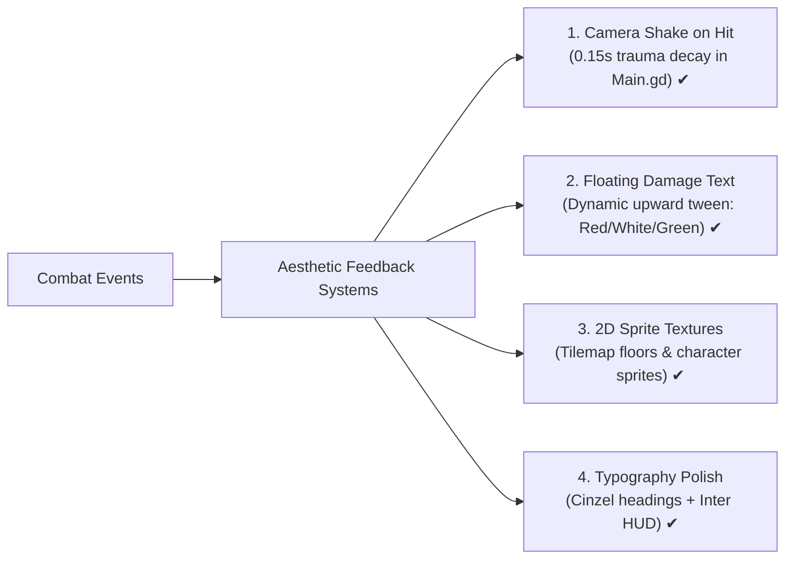
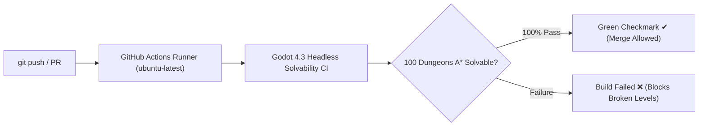
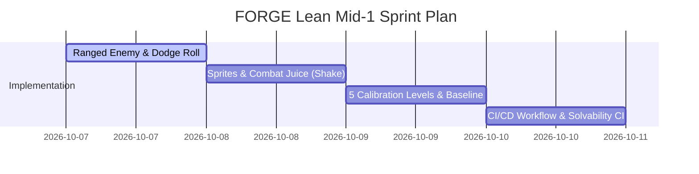

# FORGE — FYP-1 Mid-Evaluation Lean Implementation Plan

**Project:** F26-012-FORGE — Personalized Procedural Content Generation via Reinforcement Learning  
**Target Milestone:** Stage 2 / Gates 2 & 3 (Mid-1 Evaluation — Week 10)  
**Authors & Leads:** Rayan Ahmed (23i-0018), Rana Raza Ahmed (23i-0060), Uwaid Munir (23i-2574)  
**Faculty Supervisor:** Ms. Mehreen Javaid  

---

## 1. Scope Boundary: Strict Mid-1 Commitments vs. Deferred Items

To prevent scope creep and avoid doing work scheduled for later gates, this plan strictly confines development to what was promised in **Proposal §4.3 & §6.1**, **Defense Slide 9**, the **Committee Defense Reply**, and the **FAST CI/CD Directive**.

```text
┌────────────────────────────────────────────────────────────────────────┐
│                   IN-SCOPE FOR MID-1 (WEEKS 7–10)                      │
├────────────────────────────────────────────────────────────────────────┤
│ 1. Dungeon Sprites & Aesthetics: Replace raw circles with 2D sprites,  │
│    add camera shake + floating damage text (Slide 9 & Committee). [✔]  │
│ 2. Enemy Attack Variety: Add a Ranged Caster (projectile) alongside    │
│    the Melee Crawler (Committee directive).                            │
│ 3. Cold-Start Protocol: 5 fixed placement levels before PPO loop       │
│    (Proposal §5.4 & Table 4.1).                                        │
│ 4. Static Baseline Mode: Playable roguelike mode without AI            │
│    (Committee directive).                                              │
│ 5. Telemetry Logger: Keep flat JSON logger with exploration metric     │
│    (Slide 9: "Telemetry logging pipeline").                            │
│ 6. FAST CI/CD Pipeline: Headless Godot solvability test on GitHub      │
│    Actions (FAST School Directive).                                    │
│ 7. Documentation: Compile formal SRS (Gate 2) & SDS (Gate 3) from      │
│    already-written FR-01–FR-07 and NFR-01–NFR-06 specifications.       │
└────────────────────────────────────────────────────────────────────────┘
```

### ⛔ Explicitly Deferred Items (DO NOT TOUCH FOR MID-1)
* **SQLite Database Migration:** Deferred to **Gate 3 (Final-1)** per Proposal Table 4.1. Flat JSON (`session_telemetry.json`) remains our operational telemetry store for Mid-1.
* **4–5 Enemy Archetypes & 8D Softmax:** The full 4–5 archetype ecosystem is committed for **Gate 3 Exit (Final-1)** per Table 4.1. Mid-1 only requires **2 distinct attack behaviors** (Melee + Ranged).
* **Rule-Based BSP Generator Baseline:** Scheduled for **Final-1 (Week 14)** in Gantt schedule §6.2.
* **In-Run Equipment Shop Economy:** Scheduled across **Final-1 (Week 14)**.
* **Empirical ML Judge Regressor & TreeSHAP:** Scheduled for **Mid-2 (Week 26 / FYP-2)** (§6.2, §7.1 WP 9). Gate 1 linear proxy remains active.
* **10-Participant Human UAT Study:** Scheduled for **Final-2 (Week 32 / Gate 5)**.

---

## 2. Work Package 1: Enemy Attack Variety & Non-AI Baseline

### 2.1 The Two Enemy Types (Melee vs. Ranged)
Addressing the committee's mandate: *"keep a variety of attacks for enemy and player powers"*:

| Enemy Type | Visual Representation | Movement & AI Behavior | Attack Behavior |
| :--- | :--- | :--- | :--- |
| **1. Melee Crawler** *(Existing, Polished)* | Red/purple demon crawler sprite (`enemy_crawler.png`). | Chases player directly when within aggro radius ($240\text{ px}$). | Melee contact bite/slash ($20\text{ dmg}$) with $0.8\text{s}$ attack cooldown. |
| **2. Ranged Pyromancer** *(New Mid-1 Addition)* | Robed cultist/caster sprite (`enemy_pyromancer.png`). | Keeps distance ($180–220\text{ px}$); retreats if player approaches too close. | Shoots a telegraphed fireball projectile (`projectile_fireball.png`, $18\text{ dmg}$, speed $240\text{ px/s}$) with $0.5\text{s}$ yellow charge-up tell. |

### 2.2 Player Combat Feedback
* Add **Player Dodge Roll / Dash (`Spacebar`)**: Short burst dash ($0.2\text{s}$) with invulnerability frames and a $1.0\text{s}$ cooldown, giving the player an active evasion tool against ranged fireballs.

### 2.3 Static Baseline Toggle (Playable Without AI)
Addressing the committee's mandate: *"your game should also give a good, playable, engaging experience without AI"*:
* In `godot_prototype/scripts/DefenseOverlay.gd`, add a toggle button:
  * `Mode: Adaptive Closed-Loop (PPO)`
  * `Mode: Static Baseline (Non-Adaptive)`: Disables PPO observation updates. Dungeon difficulty scales deterministically by a fixed $+8\%$ enemy health/damage per floor, serving as the classic roguelike baseline.

---

## 3. Work Package 2: Visual Aesthetics & "Dungeon Sprites" Build ✅ *(COMPLETED)*

Fulfilling Slide 9 (*"Dungeon sprites & UI build"*) and the committee's aesthetics critique:



1. **Sprite & Tile Integration:** ✅
   * Replaced procedural vector circles in `godot_prototype/scripts/Player.gd` and `godot_prototype/scripts/Enemy.gd` with authentic 2D pixel-art top-down sprites:
     * `player.png` (armored knight with helm, pauldrons, breastplate, dynamic movement bob and sword flash FX).
     * `enemy_crawler.png` (demonic crawler with carapace chitin, horns, glowing eyes, scuttle scale animation).
     * `enemy_pyromancer.png` & `projectile_fireball.png` (prepared for Ranged enemy).
     * `hazard_spikes.png` (steel floor grate with sharp spikes & prick punch tween).
     * `pickup_potion.png` (glass potion flask with floating bob & pulse).
     * `portal_exit.png` (swirling runic dimensional vortex with continuous rotation).
   * Applied cohesive 2D dungeon stone brick flagstones with room-type variations (`tile_floor_stone.png`, `tile_floor_start.png`, `tile_floor_hazard.png`, `tile_floor_treasure.png`, `tile_floor_exit.png`, `tile_wall_top.png`) in `godot_prototype/scripts/Room.gd`.
2. **Combat Juice (Trauma Shake & Damage Floaters):** ✅
   * **Camera Shake:** In `godot_prototype/scripts/Main.gd`, integrated trauma-based screen shake ($0.15\text{s}$ decaying trauma on player hit, hazard pricks, and enemy kills).
   * **Damage Floaters:** Created reusable `godot_prototype/scenes/DamageFloater.tscn` with upward tween and scale pop:
     * Yellow/Gold: Damage dealt to enemy.
     * Crimson/Red: Damage taken by player.
     * Emerald Green: Health recovered from potions.
3. **Typography & UI Polish:** ✅
   * Downloaded and integrated Google Fonts in `godot_prototype/assets/fonts/`:
     * **Cinzel** for defense panel headers, room badges, difficulty score, and buttons.
     * **Inter** for clean telemetry readouts, slider value indicators, and damage floaters.

---

## 4. Work Package 3: 5 Placement Calibration Levels (Cold-Start Protocol) ✅ *(COMPLETED)*

### 4.1 Rationale & Implementation Methodology (Proposal §5.4 / FR-06)
In `FORGE_Proposal.md` (§5.4), we committed to a Cold-Start Protocol with 5 pre-validated calibration tiers to seed the player's initial skill profile before closed-loop adaptation begins.
Rather than using brittle hand-drawn static tilemaps, these 5 levels are procedurally generated by `DungeonGenerator.gd` conditioned on escalating difficulty parameter vectors ($\vec{E}$ and $\vec{M}$) configured in `DifficultyManager.gd`:

```text
Floor 1 (Intro)          Floor 2 (Melee Swarm)    Floor 3 (Traps & Evasion) Floor 4 (Tactical Crucible) Floor 5 (Apex Gauntlet)
┌─────────────────┐      ┌─────────────────┐      ┌─────────────────┐       ┌──────────────────┐        ┌──────────────────┐
│ 3 Rooms         │      │ 4 Rooms         │      │ 4 Rooms         │       │ 5 Rooms          │        │ 5 Rooms          │
│ HP: 35 | Dmg: 10│ ───> │ HP: 45 | Dmg: 14│ ───> │ HP: 55 | Dmg: 18│ ────> │ HP: 70 | Dmg: 24 │ ─────> │ HP: 90 | Dmg: 30 │
│ Spd: 85 | Haz:5%│      │ Spd: 110|Haz:15%│      │ Spd: 135|Haz:38%│       │ Spd: 155|Haz:50% │        │ Spd: 175|Haz:65% │
│ Count Scale: 0.7│      │ Count Scale: 0.9│      │ Count Scale: 1.0│       │ Count Scale: 1.15│        │ Count Scale: 1.30│
└─────────────────┘      └─────────────────┘      └─────────────────┘       └──────────────────┘        └──────────────────┘
```

1. **Floor 1 (Novice Initiation):** 3 rooms; baseline pace calibration, slow low-damage adversaries, minimal hazards (5%).
2. **Floor 2 (Swarm Reflex):** 4 rooms; melee combat reflexes, standard enemy density (scale $\times 0.9$), 15% hazard traps.
3. **Floor 3 (Evasion & Traps):** 4 rooms; spatial awareness under fire, agile adversaries (speed 135 px/s), 38% trap density.
4. **Floor 4 (Tactical Crucible):** 5 rooms; attrition and endurance test, resilient adversaries (HP 70, dmg 24), 50% hazards, scarce pickups.
5. **Floor 5 (Apex Gauntlet):** 5 rooms; maximum stress test, high-speed adversaries (speed 175 px/s, dmg 30), 65% traps.

### 4.2 Non-Uniform Difficulty-Weighted Aggregation ($CR_0$ Math)
A naive flat average across all 5 floors would distort player capability (e.g. breezing through the trivial Floor 1 would artificially mask struggling in Floor 5). 

To ensure rigorous profiling, `TelemetryLogger.gd` (`compute_cr0_baseline()`) records per-floor telemetry slices and calculates an **escalating difficulty-weighted composite score**:

$$\vec{w} = [w_1, w_2, w_3, w_4, w_5] = [1.0, 1.5, 2.0, 2.5, 3.0] \quad (\sum w_i = 10.0)$$

- **Floor 1 Weight = 1.0** (Simple navigation baseline)
- **Floor 2 Weight = 1.5** (Basic swordplay response)
- **Floor 3 Weight = 2.0** (Agile threat & trap evasion)
- **Floor 4 Weight = 2.5** (Tactical attrition under scarce resources)
- **Floor 5 Weight = 3.0** (High-intensity stress test — 3× the influence of Floor 1)

For each floor $i$, the engine evaluates:
1. **Pace Efficiency ($P_i$):** Measured in seconds per room relative to standard pace ($7.5\text{s/room}$ target):
   $$\text{Pace}_i = \text{clamp}\left(1.0 - \frac{\text{sec\_per\_room}_i - 5.0}{12.0}, 0.0, 1.0\right)$$
2. **Survival Execution ($S_i$):** Evaluated from death count ($0\text{ deaths} = 1.0$, $1\text{ death} = 0.5$, $\ge 2\text{ deaths} = 0.0$).
3. **Damage Resistance ($D_i$):** Evaluated from total health pool attrition ($\text{clamp}(1.0 - \text{damage}_i / 120.0, 0, 1)$).

The composite Initial Combat Rating ($CR_0 \in [10, 95]$) is synthesized as:
$$CR_0 = \left(\frac{\sum w_i S_i}{\sum w_i} \times 40.0\right) + \left(\frac{\sum w_i D_i}{\sum w_i} \times 35.0\right) + \left(\frac{\sum w_i P_i}{\sum w_i} \times 25.0\right)$$

### 4.3 Seeding the Adaptive Closed-Loop PPO Policy (Floor 6+)
At the exit of Floor 5:
1. `TelemetryLogger.compute_cr0_baseline()` calculates the composite $CR_0$ and maps it to initial weighted observation signals:
   $$s_0 = [\text{norm\_time}, \text{norm\_deaths}, \text{norm\_dmg\_ratio}, \text{norm\_hp}, \text{norm\_dmg}, \text{norm\_haz}, \text{norm\_rooms}, \text{norm\_level}]$$
2. `DifficultyManager.build_observation_from_cr0()` passes $s_0$ into `PPOPolicy.predict(s_0)`.
3. The resulting action vector $a_0$ denormalizes directly into Floor 6's difficulty parameters ($\vec{E}, \vec{M}$), ensuring Floor 6 starts from a personalized baseline reflecting the player's true ability.
4. From Floor 7 onward, the system continues online rolling step-by-step PPO adaptation.

---

## 5. Work Package 4: FAST CI/CD Pipeline Implementation

### 5.1 Pipeline Scope
In direct compliance with the FAST School of Computing directive (`TODO.md`), we configure an automated GitHub Actions pipeline.



### 5.2 Workflow File: `.github/workflows/godot_ci.yml`
* **Runner:** `ubuntu-latest`.
* **Tooling:** Godot 4.3 headless via `chickensoft-games/setup-godot@v1`.
* **Execution:** Runs `godot --headless --script test/test_solvability.gd`.
* **Test Suite:**
  1. Instantiates `DungeonGenerator.gd`.
  2. Generates **100 procedural dungeons** using randomized seeds.
  3. Runs an automated A* flood-fill reachability check verifying Start Room $\rightarrow$ Exit Portal path connectivity.
  4. Build fails if solvability is $< 100\%$.

---

## 6. Work Package 5: Formal Engineering Documentation (Gates 2 & 3)

The documentation standard requires formal approval of the **Software Requirements Specification (SRS — Gate 2)** and **Software Design Specification (SDS — Gate 3)**:

1. **SRS Document (Gate 2):**
   * Package the functional requirements already defined in Proposal §4.3.2 (`FR-01` to `FR-07`).
   * Package the measurable non-functional requirements already defined in Proposal §4.3.3 (`NFR-01` to `NFR-06`).
2. **SDS Document (Gate 3):**
   * Package the component architecture, GDScript inference pipeline, and flat JSON telemetry schema from Proposal §5.
3. **Traceability Matrix:**
   * Open the matrix table mapping `FR-01`–`FR-07` to design modules and the CI solvability test.

---

## 7. Streamlined 4-Day Execution Schedule



### Day-by-Day Task Allocations

* **Day 1: Ranged Enemy & Evasion**
  * In `godot_prototype/scripts/Enemy.gd`, add `RANGED` archetype with standoff distance logic and fireball projectile scene.
  * In `godot_prototype/scripts/Player.gd`, add dash/dodge roll on `Spacebar`.
* **Day 2: Aesthetics Polish & Sprites (Completed)**
  * Replace circle drawings with 2D sprites/textures for player, enemies, and floor tiles.
  * Add camera trauma shake and floating damage numbers on hit.
  * Apply Google Fonts (Cinzel / Inter).
* **Day 3: 5 Calibration Maps & Static Baseline**
  * In `godot_prototype/scripts/DungeonGenerator.gd`, define fixed calibration maps for Floors 1–5.
  * In `godot_prototype/scripts/DefenseOverlay.gd`, add the "Static Baseline vs Adaptive PPO" toggle.
* **Day 4: CI/CD Pipeline & Documentation Assembly**
  * Write `test/test_solvability.gd` and configure `.github/workflows/godot_ci.yml`.
  * Assemble the formal SRS/SDS document from `FORGE_Proposal.md` content.

---

## 8. Team Accountability (WBS Split)

| Member | Primary Ownership for Mid-1 | Specific Deliverables |
| :--- | :--- | :--- |
| **Rayan Ahmed** *(Lead)* | **Documentation & Calibration Profiling** | • Compile formal SRS & SDS document and open Traceability Matrix.<br/>• Calibration skill calculation formula and baseline profile seeding.<br/>• Maintain supervisor updates. |
| **Uwaid Munir** | **Godot Gameplay & Visual Polish** | • Ranged Enemy projectile system & Player dodge roll.<br/>• Sprite integration, camera shake, and floating damage numbers.<br/>• Fixed calibration map loader in `DungeonGenerator.gd`. |
| **Rana Raza Ahmed** | **CI/CD Pipeline & Baselines** | • Automated A* headless solvability test script (`test_solvability.gd`).<br/>• GitHub Actions workflow configuration (`godot_ci.yml`).<br/>• Static non-adaptive baseline toggle. |
