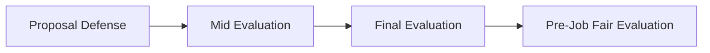

# FYP Proposal Outline

A structured outline and guidelines for the Final Year Project (FYP) proposal based on project requirements and evaluation standards.

---

## 1. Project Overview & Motivation
- **Project Overview:** High-level introduction to the domain and problem statement.
- **Motivation:** Core reason for choosing this problem and the value/impact of solving it.

---

## 2. Literature Review / Survey
- **Survey Research:** Academic papers, existing approaches, and theoretical foundations.
- **Market Analysis:** Review of existing commercial solutions, competitor products, and market gaps.

---

## 3. High-Level Goals (Tabular Format)

| Goal Category | Description / Basis | Key Deliverable |
| :--- | :--- | :--- |
| **Research** | Grounded in academic literature and research papers | Research paper / novel findings |
| **Development** | Driven by market analysis and functional demand | Robust, market-ready system |
| **Novelty** | Driven by user surveys and stakeholder interviews | Unique features / novel approach |
| **Product Delivery** | End-to-end usable solution | Fully functioning application / final product |

---

## 4. Project Scope *(Fixed — Must Not Change)*
- **Complex Computing Problem (CCP):** Must satisfy CCP criteria.
- **CCP Guidelines:** Strict adherence to CCP guidelines is mandatory (detailed in `FAST_FYP_Student_Idea_Selection_Guide_School_of_Computing.pdf`).

---

## 5. Proposed Solution *(Subject to minor refinements)*
- Architectural blueprint, proposed methodology, and technical approach to address the problem.

---

## 6. Timeline & Iterations *(Adaptable)*
Divided into sequential iterations where each stage must produce a tangible deliverable:

> [!IMPORTANT]
> **Deliverable Guidelines:**
> - Each milestone must deliver an integrated, functional slice of the project.
> - Deliverables must **not** be purely frontend or purely backend in any phase.

---

## 7. Work Breakdown Structure (WBS)
- Detailed task breakdown mapped to individual team members (who does what, deliverables, and accountability).

---

## 8. Tools & Technology *(Can be adjusted)*
- Tech stack: Languages, frameworks, databases, libraries, and deployment tools.

---

## 9. References & Citations
- **Citation Format:** IEEE Style.
- **Requirement:** In-text citations are **mandatory** throughout the proposal document.