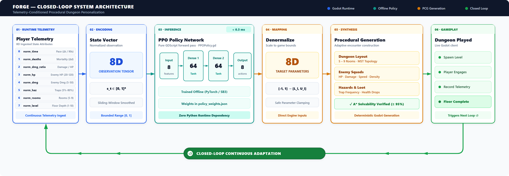

# FORGE: Personalized Procedural Content Generation via Reinforcement Learning

> **Player-telemetry-inferred, structured difficulty conditioning for combat dungeon crawlers**  
> FAST–NUCES Islamabad · Department of Artificial Intelligence · Final Year Project (FYP)

---

## 🎮 Project Overview

**FORGE** is a research-driven closed-loop game balancing and level generation framework. It bridges real-time player telemetry, reinforcement-learning-based dynamic difficulty conditioning, and procedural dungeon generation. 

Traditional Dynamic Difficulty Adjustment (DDA) often relies on blunt stat-scaling (e.g., boosting enemy health or damage), which undermines player agency. FORGE instead generates tailored spatial layouts, enemy encounter densities, and hazard placements via a **Controllable Procedural Content Generation via Reinforcement Learning (PCGRL)** loop conditioned on the player's demonstrated mechanical proficiency and pacing.



### The Closed-Loop Pipeline
1. **Player Telemetry Ingestion:** Continuous tracking of combat efficiency, damage intake, reaction latency, and exploration pace.
2. **State & Difficulty Conditioning:** Inferring player flow state and selecting structured target challenge levels.
3. **PCGRL Content Generation:** Training RL agents to construct navigable, balanced dungeon rooms and combat encounters.
4. **Real-time Deployment:** Seamlessly streaming newly generated rooms and adaptive parameters into the game engine.

---

## 📁 Repository Structure

```text
├── godot_prototype/           # Playable 2D combat dungeon prototype (Godot 4.x)
│   ├── assets/                # Pixel art sprites, Google Fonts, and visual themes
│   ├── scenes/                # Player, Enemy, Hazard, Pickup, Room, DamageFloater scenes
│   ├── scripts/               # GDScript gameplay logic, telemetry logging, camera shake
│   └── project.godot          # Godot project configuration
├── ml_spike/                  # Reinforcement learning experiments & prototypes
│   ├── train_ppo_difficulty.py # Stable-Baselines3 PPO model for difficulty parameter adjustment
│   ├── ppo_difficulty_model.zip # Trained demonstration checkpoint
│   └── requirements.txt       # Python dependencies for ML experiments
├── papers/                    # Curated academic research library
│   ├── dynamic_difficulty_adjustment/ # DDA research papers
│   └── pcgrl_and_foundations/         # PCGRL, player modeling, and evaluation papers
├── assets/                    # System architecture diagrams and visual figures
├── archive/                   # Archived early concept outlines and initial spikes
├── FORGE_Proposal.md          # Comprehensive FYP proposal and research documentation
├── MID_EVAL_IMPLEMENTATION_PLAN.md # Lean Mid-Evaluation sprint plan and team task split
├── FORGE_FYP_Proposal_Final.docx # Official formatted proposal document
├── FORGE_Proposal_Defense.pptx   # Defense presentation slide deck
├── FYP_Committee_Defense_Feedback.md # Evaluator feedback and committee action items
└── TODO.md                    # Work packages and development roadmap
```

---

## 🚀 Getting Started

### 1. Playing the Godot Prototype
- **Engine Version:** Godot Engine 4.2+ (or 4.3)
- **Setup:**
  1. Open Godot and select **Import**.
  2. Browse to `godot_prototype/project.godot` and import the project.
  3. Press **F5** (or Run Project) to launch `scenes/Main.tscn`.
- **Controls:**
  - `W / A / S / D` or Arrow Keys: Move Player
  - `Space` or Left Click: Attack / Swing Weapon
  - `Esc`: Pause / Inspect Telemetry & Defense Overlay

### 2. Running the ML Difficulty Spike
- **Requirements:** Python 3.10+
- **Setup:**
  ```bash
  cd ml_spike
  pip install -r requirements.txt
  python train_ppo_difficulty.py
  ```

---

## 👥 Project Team & Supervision

| Role | Name | Identifier |
| :--- | :--- | :--- |
| **Team Member** | Rayan Ahmed | 23i-0018 |
| **Team Member** | Rana Raza Ahmed | 23i-0060 |
| **Team Member** | Uwaid Munir | 23i-2574 |
| **Supervisor** | Ms. Mehreen Javaid | Department of Artificial Intelligence |
| **Institution** | FAST–NUCES, Islamabad | School of Computing |

---

## 📄 License & Academic Integrity

This repository is maintained as part of the Senior Final Year Project at the National University of Computer and Emerging Sciences (FAST-NUCES). All academic sources are cited in `FORGE_Proposal.md` and organized in `papers/`.
