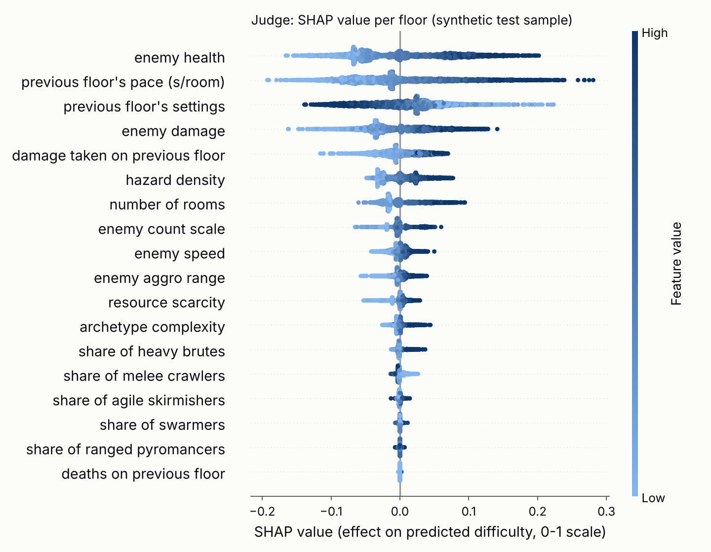
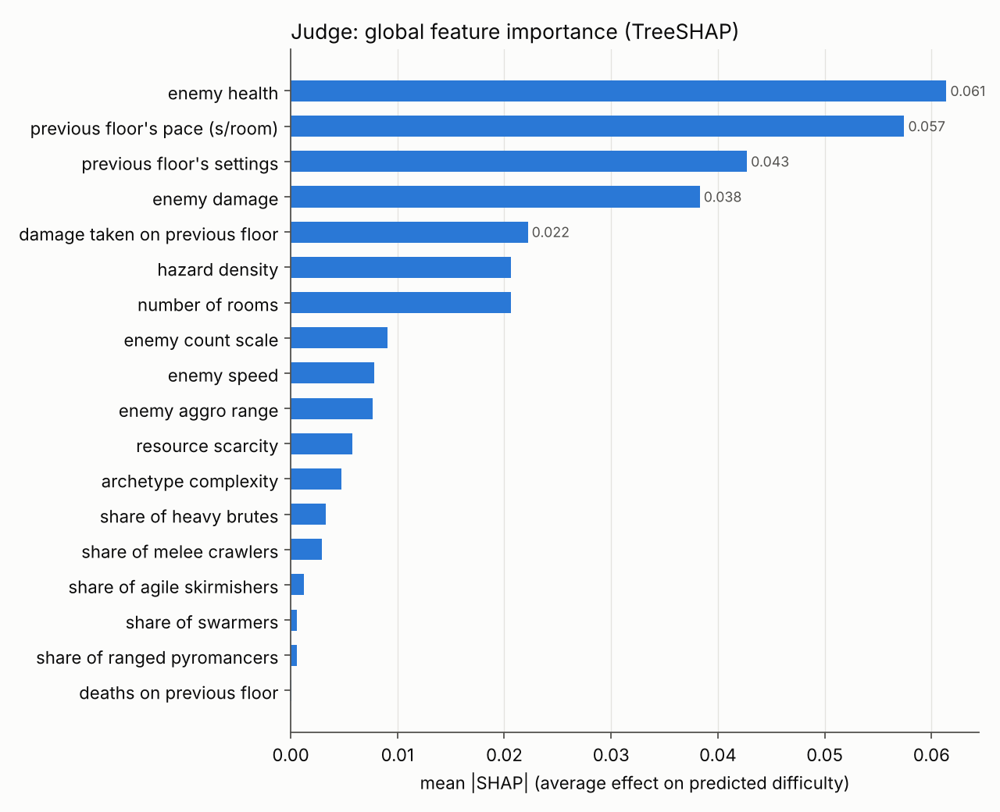
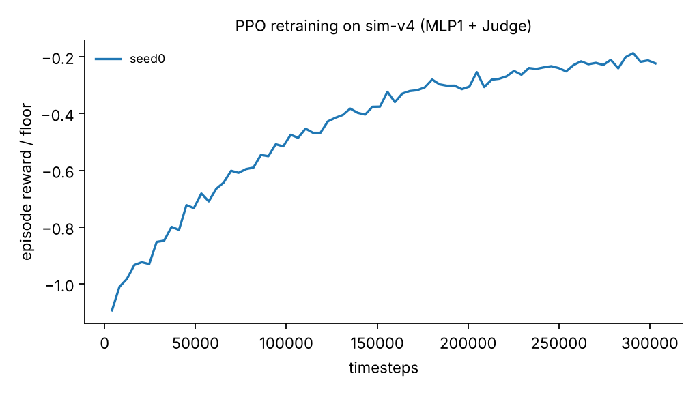
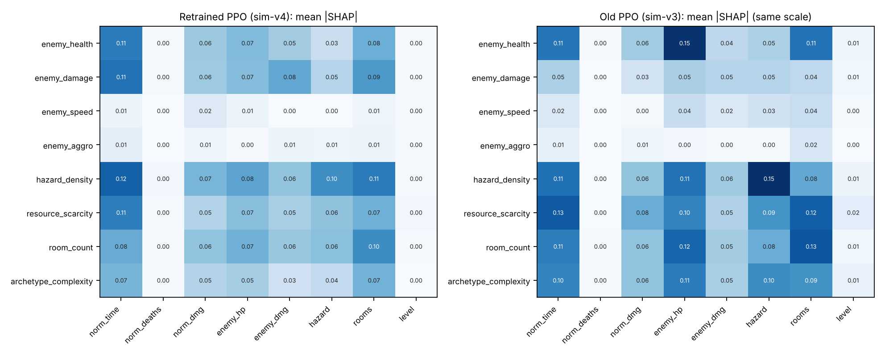
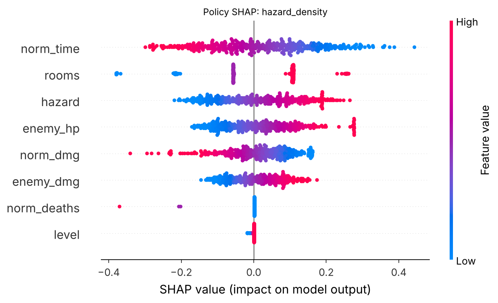
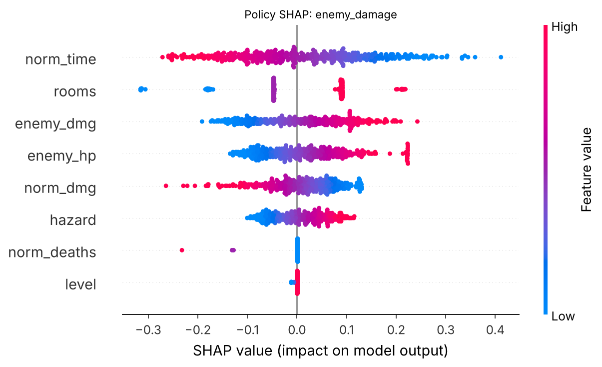
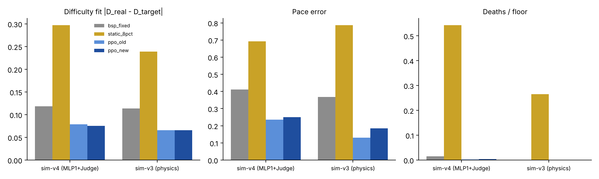
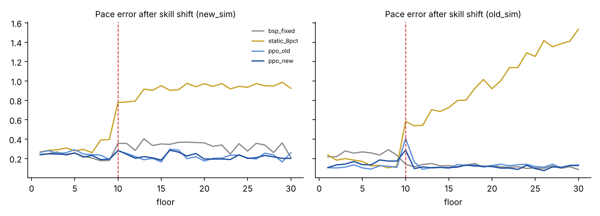
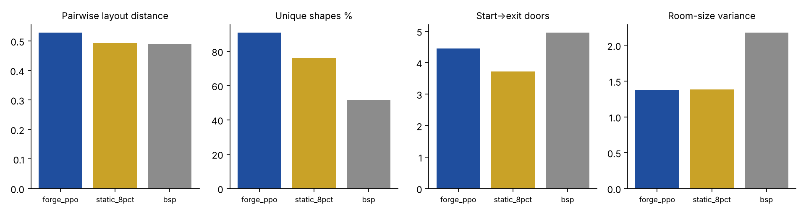

# FORGE ML pipeline results

> **Synthetic data warning.** At least one model below was trained on SYNTHETIC data. Those numbers show the pipeline works; they are not evidence about real players.

**Where every model's data came from**

| Stage | Data source | Detail |
|---|---|---|
| 1 MLP1 player model | SYNTHETIC | 400 player(s), split by_player |
| 2 Judge | SYNTHETIC | trained on the sim-v3 synthetic corpus (ml/runs/synthetic_check/2_judge/synthetic_corpus.csv) |

**MLP1 validation MAE (synthetic data, split by_player, n=954)**

| Predictor | time (s) | deaths | damage ratio |
|---|---|---|---|
| model | 9.262 | 0.033 | 0.099 |
| base_only | 12.951 | 0.029 | 0.133 |
| train_average | 22.717 | 0.052 | 0.237 |

**MLP1 calibration**

| Output | 80% interval coverage (ideal 0.80) |
|---|---|
| time | 0.806 |
| deaths | 0.798 |
| damage | 0.861 |

**Judge vs the old hand-weighted formula on held-out players (600 players, 6107 floors, synthetic data)**

| Model | MAE | RMSE | R2 |
|---|---|---|---|
| LightGBM Judge | 0.052 | 0.076 | 0.823 |
| old formula (difficulty_score/100) | 0.206 | 0.242 | -0.780 |
| old formula, rescaled | 0.104 | 0.135 | 0.445 |
| linear regression | 0.069 | 0.094 | 0.734 |
| mean predictor | 0.146 | 0.182 | -0.000 |

**Judge on real telemetry rows (players not in training; n is small)**

| Against | n | Judge MAE | Old formula MAE |
|---|---|---|---|
| measured | 3958 | 0.052 | 0.202 |

**New simulator (MLP1 + Judge) sanity run, 20 episodes each**

| Policy | reward/floor | pace err | deaths | D_judge | D_real |
|---|---|---|---|---|---|
| random | -0.991 | 0.429 | 0.135 | 0.316 | 0.351 |
| static_8pct | -1.675 | 0.679 | 0.520 | 0.470 | 0.524 |
| ppo_old | 0.179 | 0.223 | 0.000 | 0.224 | 0.224 |

**New simulator response checks**

| Check | Passed |
|---|---|
| damage_rises_with_enemy_damage | yes |
| judge_rises_with_enemy_damage | yes |
| damage_falls_with_skill | yes |
| finite_rewards | yes |

**Exploit check of the retrained PPO (40 held-out episodes)**

| Measure | Value | Limit / reference |
|---|---|---|
| mean abs(D_judge - D_real) | 0.073 | <= 0.104 |
|   same, random actions | 0.105 | reference |
|   same, old PPO | 0.072 | reference |
| judge bias (D_real - D_judge) | 0.003 | ~0 |
| out-of-range settings | 0.000 | <= 0.1 |
| actions at the box edge | 0.006 | <= 0.3 |
| MLP1 spread, chosen floors | 0.011 | random: 0.019 |
| old-sim pace err, new PPO | 0.183 | old PPO: 0.130 |
| PASSED | yes | all checks |

**PPO seeds (best is exported)**

| Seed | Validation reward / floor |
|---|---|
| 0 (best) | 0.126 |

**What drives each setting the policy picks (mean |SHAP|)**

| Action (setting) | Top observation (new PPO) | Top observation (old PPO) |
|---|---|---|
| enemy_health | norm_time | enemy_hp |
| enemy_damage | norm_time | enemy_hp |
| enemy_speed | norm_dmg | enemy_hp |
| enemy_aggro | norm_time | rooms |
| hazard_density | norm_time | hazard |
| resource_scarcity | norm_time | norm_time |
| room_count | rooms | rooms |
| archetype_complexity | rooms | enemy_hp |

**FORGE vs baselines in sim-v4 (MLP1 + Judge), 30 episodes x 5 skill profiles**

| Condition | fit err | pace err | deaths | damage | shift impact | recovery floors |
|---|---|---|---|---|---|---|
| bsp_fixed | 0.119 | 0.411 | 0.015 | 0.319 | 0.124 | - |
| static_8pct | 0.297 | 0.692 | 0.543 | 0.679 | 0.460 | - |
| ppo_old | 0.079 | 0.236 | 0.002 | 0.259 | 0.011 | 1 |
| ppo_new | 0.075 | 0.250 | 0.004 | 0.265 | 0.026 | 2 |

**FORGE vs baselines in sim-v3 (physics), 30 episodes x 5 skill profiles**

| Condition | fit err | pace err | deaths | damage | shift impact | recovery floors |
|---|---|---|---|---|---|---|
| bsp_fixed | 0.114 | 0.368 | 0.000 | 0.220 | -0.126 | 1 |
| static_8pct | 0.239 | 0.787 | 0.265 | 0.599 | 0.425 | - |
| ppo_old | 0.066 | 0.131 | 0.000 | 0.254 | 0.110 | 3 |
| ppo_new | 0.066 | 0.186 | 0.000 | 0.242 | 0.005 | 2 |

**Layout variety and solvability**

| Generator | solvable % | rooms | path | dead ends | size var | unique % | pairwise dist |
|---|---|---|---|---|---|---|---|
| forge_ppo | 100.000 | 6.730 | 4.447 | 2.717 | 1.371 | 91.000 | 0.529 |
| static_8pct | 100.000 | 6.000 | 3.720 | 2.657 | 1.384 | 76.000 | 0.493 |
| bsp | 100.000 | 6.597 | 4.960 | 2.490 | 2.180 | 51.667 | 0.490 |

## Figures





Example Design Insight Report:

```
Design Insight Report, session syn_7_00000 (ml/runs/synthetic_check/0_data/smoke_telemetry.csv)

Floor 1 (calibration): predicted difficulty 0.07 (average floor 0.26, -0.19).
  Easier than average mostly because enemy health was low (35) (-0.07), enemy damage was low (10) (-0.04) and hazard density was low (0.05) (-0.03).
  Actual: measured 0.05.

Floor 2 (calibration): predicted difficulty 0.07 (average floor 0.26, -0.19).
  Easier than average mostly because the previous floor was fast (2.3 s/room) (-0.07) and enemy health was low (45) (-0.05).
  Pulling the other way: the previous floor's settings were easy (score 12/100) (+0.06).
  Actual: measured 0.08.

Floor 3 (calibration): predicted difficulty 0.12 (average floor 0.26, -0.13).
  Easier than average mostly because the previous floor was fast (4.0 s/room) (-0.06) and enemy health was moderate (55) (-0.05).
  Pulling the other way: the previous floor's settings were easy (score 24/100) (+0.04).
  Actual: measured 0.12.

Floor 4 (calibration): predicted difficulty 0.21 (average floor 0.26, -0.05).
  Easier than average mostly because the previous floor was fast (5.2 s/room) (-0.07) and damage taken on the previous floor was moderate (7% of max HP) (-0.02).
  Pulling the other way: hazard density was moderate (0.50) (+0.02).
  Actual: measured 0.30.

Floor 5 (calibration): predicted difficulty 0.55 (average floor 0.26, +0.29).
  Harder than average mostly because enemy health was high (90) (+0.10), the previous floor was slow (11.3 s/room) (+0.06) and the enemy count scale was high (1.30) (+0.04).
  Actual: measured 0.56.

Floor 6 (adaptive): predicted difficulty 0.22 (average floor 0.26, -0.04).
  Easier than average mostly because the previous floor's settings were hard (score 68/100) (-0.07) and enemy health was low (42) (-0.07).
  Pulling the other way: the previous floor was slow (17.7 s/room) (+0.10).
  Actual: measured 0.13.

Floor 7 (adaptive): predicted difficulty 0.10 (average floor 0.26, -0.16).
  Easier than average mostly because enemy health was low (45) (-0.05), enemy damage was low (13) (-0.04) and the previous floor was on-target (5.6 s/room) (-0.03).
  Actual: measured 0.18.

Floor 8 (static): predicted difficulty 0.49 (average floor 0.26, +0.24).
  Harder than average mostly because the previous floor's settings were easy (score 29/100) (+0.10), enemy health was high (98) (+0.09) and enemy damage was moderate (33) (+0.04).
  Actual: measured 0.46.

Floor 9 (static): predicted difficu
```














