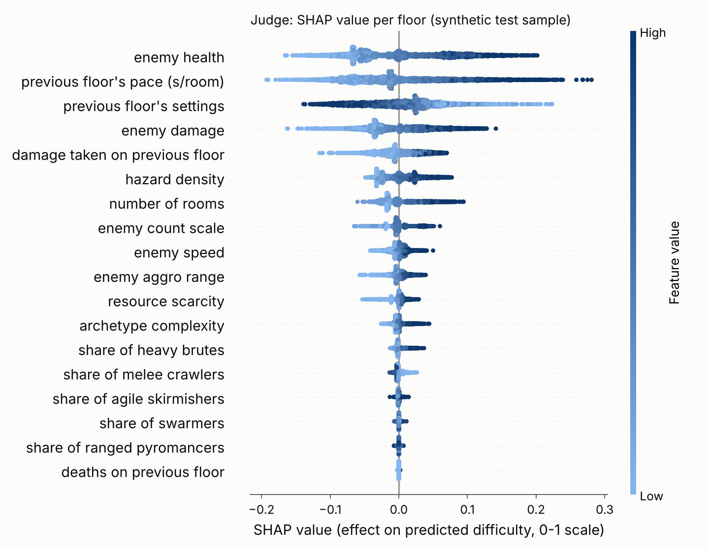
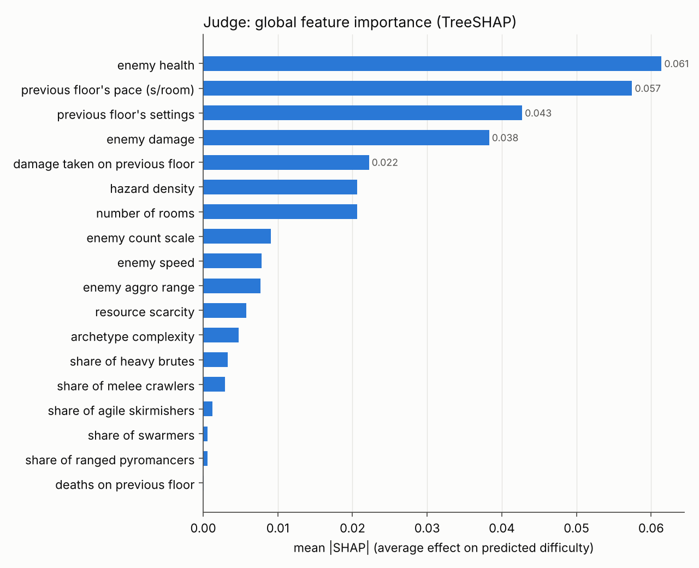
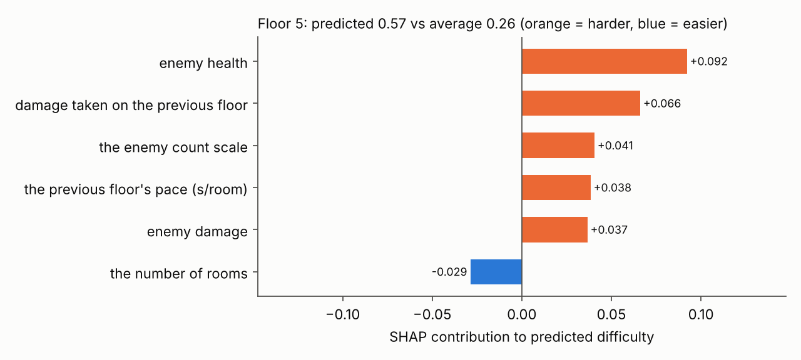

# FORGE Judge model: results (FYP-1 Final)

The Judge predicts **how hard a floor with given settings will be for a given player**, as one
number in [0, 1]. It replaces the hand-weighted linear score
(`DifficultyManager.calculate_difficulty_score()`, `difficulty_score()` in
`ml_spike/train_ppo_difficulty.py`) with a LightGBM model learned from data, and TreeSHAP explains each
prediction.

> **Data honesty.** The model is trained on **synthetic** data from the sim-v3 player simulator. The
> real-data check uses **29 floors from 3 sessions, all from one install (one player)**. That is far
> too small to draw conclusions. The 25+ player real corpus and retraining on it are FYP-2 work. The
> pipeline already accepts that corpus with no code change (`--corpus <file> --target rating`).

Model trained at commit `24d99eb` (`judge_model.json` → `git_commit`). All numbers below come from
`judge_model.json` and were reproduced by a second clean run (same seed, same numbers).

## 1. Target definition

One scalar **difficulty ∈ [0, 1]**, so that "MAE ≤ 0.15" has a meaning
(code: `ml_spike/judge/common.py`).

| Case | Definition |
|---|---|
| **Primary**: the player rated the floor (1–5 prompt) | `(rating − 1) / 4` |
| **Fallback**: no rating (all synthetic rows) | `measured = 0.40·min(damage_taken / max_hp, 1) + 0.35·min(deaths, 3)/3 + 0.25·min((completion_time / rooms) / 15 s, 1)` |

- The caps reuse the normalisations of the PPO observation (damage ratio clipped to [0, 1],
  deaths / 3, time / (2 × target)). The game's target pace is 7.5 s per room, so a floor played
  exactly on pace contributes 0.125.
- Weights: damage 0.40 (the most continuous challenge signal), deaths 0.35 (the strongest but rare
  and discrete), pace 0.25 (most affected by play style and exploration).
- These constants were fixed **before** any model was trained. They were not tuned on any test data,
  synthetic or real.
- `--target auto` (default) uses the rating when there is one, otherwise the measured value.
  `--target measured` and `--target rating` force one of the two.
- The raw outcomes (completion time, deaths, damage taken) stay in the corpus and are modelled as an
  extra (§4). `damage_exchange_ratio` is left out because the simulator does not model damage dealt.

## 2. Features (18)

- The 14 `JUDGE_FEATURES`: enemy health, damage, speed, aggro, hazard density, resource scarcity,
  room count, archetype complexity, archetype mix 0..4, enemy count scale.
- **Player context from the previous floor of the same session**: `prev_time_per_room`,
  `prev_deaths`, `prev_damage_frac` (damage / max HP), and `prev_difficulty_score` (the old 0–100
  score of the previous floor's settings). The last one lets the model tell "slow on an easy floor"
  apart from "slow on a hard floor".
- I used time **per room** instead of the raw completion time the brief listed, so floors of
  different sizes are comparable.
- **First floor of a session**: there is no previous floor, so all four context features are NaN.
  LightGBM sends missing values down a learned default branch. The synthetic corpus contains 3,000
  first floors, so that branch is trained.

## 3. Data

| Corpus | Source | Rows (floors) | Sessions | Players | With rating |
|---|---|---|---|---|---|
| Training: `synthetic_corpus.csv` | **synthetic** (sim-v3, seed 0) | 30,199 | 3,000 | 3,000 (simulated) | 0 |
|  ↳ train / test split (grouped by player) | synthetic | 24,092 / 6,107 | 2,400 / 600 | 2,400 / 600 | 0 |
| Validation: game `forge_telemetry.db`, consented sessions only | **real** (playtest build 0.9.0) | 29 | 3 | **1** | 29 |

- **Synthetic generator** (`make_synthetic_corpus.py`):
  - Each session is one simulated player, with skill drift and abrupt shifts exactly as in
    `DungeonDifficultyEnv`.
  - Half the sessions open with the game's 5 calibration floors.
  - The other floors are drawn from this mix: 45 % uniform over the whole action space, 25 % a
    jittered preset (a calibration level or Intermediate), 20 % a PPO-like smooth walk, and 10 % a
    static-baseline floor (+8 %/floor, floors 1–20).
  - Columns use the same names as `v_corpus`, plus `source = "synthetic"` and three simulator-only
    columns (`sim_skill`, `sim_reflex`, `sim_tactics`), which are never used as features.
  - Anything the simulator does not model is left empty: damage dealt, kills, frame times and
    ratings.
- **Real data**:
  - The game DB is synced into a temporary copy with `TelemetryDatabase.sync_from_game_db`.
  - Only `consent = 1` sessions are used.
  - `manual_override = 1` rows are excluded. There were none.
  - An older dev DB (`forge_telemetry_old.db`: 10 floors, no consent, schema v1, no ratings) was
    left out.

## 4. Results

### 4.1 Synthetic: the learned Judge against the hand-weighted proxy

Grouped 5-fold CV on the 2,400 training players (early stopping gave 349 trees), then one fit
scored on the 600 held-out players. No player appears on both sides of any split.

| Model | CV MAE (mean ± sd) | CV R² | **Test MAE** | Test RMSE | Test R² |
|---|---|---|---|---|---|
| **LightGBM Judge** | 0.0538 ± 0.0011 | 0.814 | **0.0522** | 0.0764 | **0.823** |
| Linear regression, same 18 features | 0.0704 ± 0.0005 | 0.724 | 0.0692 | 0.0937 | 0.734 |
| Old proxy, rescaled to [0,1] by a linear fit on the training players | 0.1063 ± 0.0014 | 0.430 | 0.1044 | 0.1354 | 0.445 |
| Old proxy `difficulty_score()/100` as is | 0.2075 ± 0.0043 | −0.778 | 0.2064 | 0.2424 | −0.780 |
| Mean predictor | 0.1474 ± 0.0015 | −0.001 | 0.1463 | 0.1817 | 0.000 |

- **Acceptance (MAE ≤ 0.15 and better than the proxy): met.**
- The test MAE of 0.052 is **4.0× lower than the proxy as is** and **2.0× lower than the proxy even
  after rescaling it** to fit this target.
- The learned Judge also beats a linear model on the same features (0.052 against 0.069). So part
  of the gain comes from non-linear effects and interactions (for example, saturating terms and
  settings × player-context effects), not only from re-weighting the levers.

**Extra (raw outcomes, same features, 400 trees, test players):**

| Outcome | R² | MAE |
|---|---|---|
| Completion time | 0.80 | 10.3 s |
| Damage taken | 0.75 | 10.8 HP |
| Deaths | 0.35 | 0.04 |

Deaths are rare in sim-v3 (mean 0.03 per floor), so there is little for a model to learn.

### 4.2 Real rows (n = 29, one player; **n is too small to conclude anything**)

| Against… | Judge MAE | Old proxy MAE | Mean-predictor MAE | n |
|---|---|---|---|---|
| Measured difficulty (the training target) | 0.121 | **0.109** | 0.148 | 29 |
| Player's own rating `(r−1)/4` | 0.311 | **0.162** | 0.271 | 29 |

| Spearman ρ with the player's rating | Value |
|---|---|
| Judge prediction | 0.72 |
| Old proxy | 0.80 |
| Measured difficulty (the fallback target itself) | 0.52 |

**What the numbers say (no stronger reading is justified with one player and 29 floors):**

- On real rows the synthetic-trained Judge does **not** beat the proxy. The proxy's MAE is lower
  against both targets.
- The Judge under-predicts. Its mean prediction is 0.19, while the mean measured difficulty is 0.29.
  This player took more damage on low-HP adaptive floors than sim-v3 predicts, which is a
  **sim-to-real gap** in the simulator's damage model.
- Split by phase, the Judge is closer to the measured value on adaptive floors (MAE 0.104 against
  0.113 for the proxy, n = 18). It is worse on calibration floors (0.149 against 0.103, n = 11).
- Against ratings, every model trained on the measured target sits on the wrong scale. The player
  rated almost every adaptive floor 3/5 (= 0.50), while the measured target averages 0.29. The
  measured target ranks the ratings only moderately (ρ = 0.52).
- So the outcome-based fallback is a **weak stand-in for perceived difficulty**. This is the
  strongest argument for training on ratings in FYP-2.
- The proxy's higher ρ comes mostly from the five calibration floors, whose settings rise steadily
  from easy to hard.

## 5. Explanations (TreeSHAP)

`explain.py` uses `shap.TreeExplainer` on the LightGBM booster. Each prediction splits exactly into
**base value + one contribution per feature**. The test `test_shap_additivity` checks that the
contributions add up to the prediction.

**Global** (2,000 floors from the held-out synthetic test players):




- Top 5 features by mean |SHAP|: enemy health 0.061, previous floor's pace 0.057, previous floor's
  settings 0.043, enemy damage 0.038, damage taken on the previous floor 0.022.
- **Player context ranks 2nd, 3rd and 5th**, so the Judge really does predict difficulty *for this
  player*, not just for the settings.
- `prev_deaths` contributes almost nothing, because deaths are rare in the simulator.

**Local: Design Insight Report** for a recorded real session:

```
python -m ml_spike.judge.explain --db "%APPDATA%\Godot\app_userdata\FORGE - Adaptive Dungeon Prototype\forge_telemetry.db" --session sess_1794129326_a596
```

```
Floor 5 (calibration): predicted difficulty 0.57 (average floor 0.26, +0.31).
  Harder than average mostly because enemy health was high (90) (+0.09), damage taken on the previous
  floor was high (119% of max HP) (+0.07) and the enemy count scale was high (1.30) (+0.04).
  Actual: measured 0.54, player rating 4/5 (= 0.75).

Floor 13 (adaptive): predicted difficulty 0.19 (average floor 0.26, -0.07).
  Easier than average mostly because the previous floor was fast (4.8 s/room) (-0.08) and enemy
  health was low (51) (-0.04).
  Pulling the other way: hazard density was high (0.60) (+0.02).
  Actual: measured 0.49, player rating 4/5 (= 0.75).
```

- Floor 5 is a good prediction.
- Floor 13 is shown on purpose: the model read the fast previous floor as "this player is strong"
  and under-predicted. This is the sim-to-real gap from §4.2, and the explanation makes it visible.
- How "high" and "low" are decided:
  - For the seven tunable settings: the top and bottom third of their PPO range.
  - For pace: ±25 % around the 7.5 s/room target.
  - For everything else: the training-set quartiles.



## 6. Limitations

1. **Synthetic training data.** The model learns sim-v3's view of difficulty, including its
   assumptions (for example, its damage model and its very low death rate).
2. **Simulator bias shows up on real data.** The Judge under-predicts the one real player by about
   0.10 on average, and it does not beat the hand-weighted proxy there.
3. **Real-data evaluation is not meaningful yet.** There are 29 floors, all from one install, and
   ratings with little variance (mostly 3/5). No significance can be claimed in either direction.
4. **The fallback target is a design choice, not ground truth.** Its constants are fixed and
   documented, and it ranks the player's ratings only moderately (ρ = 0.52).
5. **The Judge is offline only.** The game and PPO training still use the linear score.

## 7. FYP-2

- Collect the 25+ consented-player corpus. Then retrain with
  `python -m ml_spike.judge.train_judge --corpus corpus.db --target rating`. The split is grouped by
  `install_id`, and the trainer refuses to run with fewer than 7 players.
- Then optionally recalibrate sim-v3's damage model against real outcomes and regenerate the
  synthetic corpus as pre-training data.
- Port the trees (LightGBM JSON dump) and the SHAP contributions (`pred_contrib`) to GDScript for a
  live in-game explanation panel. Then consider using the learned Judge in PPO's reward.

## Reproduce (from the repo root)

```
python -m ml_spike.judge.make_synthetic_corpus          # 30,199 rows, ~20 s, deterministic (seed 0)
python -m ml_spike.judge.train_judge                    # CV + test + real rows (game DB auto-located) ~35 s
python -m ml_spike.judge.explain --global               # figures/shap_beeswarm.png, shap_mean_abs_bar.png
python -m ml_spike.judge.explain --db <forge_telemetry.db> --list
python -m ml_spike.judge.explain --db <forge_telemetry.db> --session <id> [--floor N --example-figure figures/insight_example.png]
```

Outputs: `judge_model.txt` (LightGBM native) and `judge_model.json` (features, target definition,
parameters, CV / test / real metrics with per-row predictions, data counts, feature quartiles, git
commit).
